_This project has been created as part of the 42 curriculum by **orobert** and **lbonnet**._
<a id="top"></a>

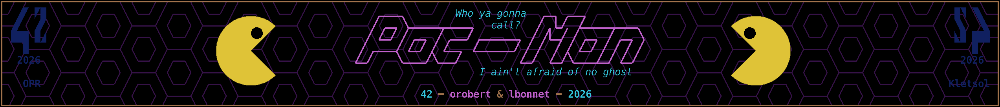

<h1 align="center">
  Pac-Man
  <br>
  Escape from Flativerses
</h1>

> **Ghosts! More ghosts!** — A reimagining of Pac-Man, a procedural graphics engine, and a few surprises that grew a little bigger than expected.

$${\color{teal}⋘⊛⋙}$$

# **$${\color{orange}Table \space of \space Contents}$$**

- [1. Description](#description)
- [2. Game Overview](#game_overview)
- [3. Software Architecture](#software_architecture)
- [4. Graphics Engine](#graphics_engine)
- [5. Maze Generation](#maze_generation)
- [6. Game Mechanics](#game_mechanics)
- [7. Controls](#controls)
- [8. Inventory and Items](#inventory)
- [9. Cheat Mode](#cheat_mode)
- [10. Mini-Games](#mini_games)
- [11. User Interface](#user_interface)
- [12. Audio](#audio)
- [13. Localization](#localization)
- [14. Configuration](#configuration)
- [15. High Scores](#highscores)
- [16. Installation and Usage](#instructions)
- [17. Distribution](#packaging)
- [18. Performance](#performance)
- [19. Design Decisions](#design_decisions)
- [20. Challenges Encountered](#challenges)
- [21. Bonus Features](#bonus_features)
- [22. Project Management](#project_management)
- [23. Resources](#resources)
- [24. AI Usage](#ai_usage)
- [25. Final Thoughts](#final_thoughts)
- [26. Contributors](#contributors)

$${\color{teal}⋘⊛⋙}$$
<a id="description"></a>

# **$${\color{orange}1. \space Description}$$**

<details><summary><strong>Section contents 🗂️</strong></summary>

- [1.1. Context](#description.context)
- [1.2. Objectives](#description.objectives)
- [1.3. Project Scope](#description.project_perimeter)

</details>

# [◀️](#top)&nbsp;&nbsp;&nbsp;[⏫](#top)&nbsp;&nbsp;&nbsp;[▶️](#game_overview)

<a id="description.context"></a>

<p align="center">
    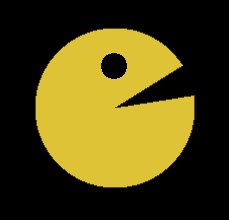
</p>

## **$${\color{violet}1.1. \space Context}$$**

Created by Namco in 1980, Pac-Man is built around an immediately understandable idea: navigate a maze, collect pacgums, and avoid four ghosts. The **Pacman** project at 42 asks students to implement a new version in Python, using mazes generated by an external package, with a graphical interface, customizable settings, and persistent high scores.

<a id="description.objectives"></a>

## **$${\color{violet}1.2. \space Objectives}$$**

**Escape from Flativerses** takes this foundation and turns it into a larger game: animated menus, multi-level progression, an inventory system, interactive items, cheat modes, mini-games, narrative sequences, music, and localization. The aim is to preserve the instantly recognizable rules of the arcade game while exploring additional technical and gameplay possibilities.

<a id="description.project_perimeter"></a>

## **$${\color{violet}1.3. \space Project \space Scope}$$**

The program was developed in **Python 3.10+** using an object-oriented architecture. It uses **Raylib** through its Python bindings for window management, input, and audio. Drawing is organized around a primitive-based engine, with a rendering mode explicitly compatible with MLX graphical capabilities. The project includes a `Makefile`, a JSON configuration file, and project management documents.

$${\color{teal}⋘⊛⋙}$$
<a id="game_overview"></a>

# **$${\color{orange}2. \space Game \space Overview}$$**

<details><summary><strong>Section contents 🗂️</strong></summary>

- [2.1. Game Loop](#game_overview.game_loop)
- [2.2. Levels and Progression](#game_overview.levels_and_progression)
- [2.3. Additional Features](#game_overview.additional_features)

</details>

# [◀️](#description)&nbsp;&nbsp;&nbsp;[⏫](#top)&nbsp;&nbsp;&nbsp;[▶️](#software_architecture)

<p align="center">
    
</p>

<a id="game_overview.game_loop"></a>

## **$${\color{violet}2.1. \space Game \space Loop}$$**

The main loop follows the assignment: **main menu → game → victory or defeat → name entry → high scores → return to menu**. The player controls Pac-Man through a maze, collects pacgums, avoids ghosts, or temporarily eats them after collecting a super-pacgum. A game can be paused, resumed, or interrupted through the interface.

<a id="game_overview.levels_and_progression"></a>

## **$${\color{violet}2.2. \space Levels \space and \space Progression}$$**

The supplied configuration defines **12 levels**, exceeding the required minimum of ten. The first uses a fixed seed for reproducibility; subsequent levels are generated with new seeds. Dimensions increase gradually from **15 × 10** to **21 × 15**. The score and remaining lives carry over between levels. The default time limit is **90 seconds** per level, with a configurable consequence when it expires.

<a id="game_overview.additional_features"></a>

## **$${\color{violet}2.3. \space Additional \space Features}$$**

The game also offers four mini-games, an inventory, animated transitions, a narrative universe, and several languages. These extensions do not replace Pac-Man's core requirements: they surround them with a broader experience. Cheat mode makes it possible to test different situations quickly during an evaluation.

$${\color{teal}⋘⊛⋙}$$
<a id="software_architecture"></a>

# **$${\color{orange}3. \space Software \space Architecture}$$**

<details><summary><strong>Section contents 🗂️</strong></summary>

- [3.1. Application Lifecycle](#software_architecture.application_life_cycle)
- [3.2. Overview](#software_architecture.overview)
- [3.3. Directory Structure](#software_architecture.arborescence)

</details>

# [◀️](#game_overview)&nbsp;&nbsp;&nbsp;[⏫](#top)&nbsp;&nbsp;&nbsp;[▶️](#graphics_engine)

<a id="software_architecture.application_life_cycle"></a>

## **$${\color{violet}3.1. \space Application \space Lifecycle}$$**

The entry point `pac-man.py` validates the configuration argument, creates `Core`, launches the application, and restores the terminal state on exit. `Core` assembles the subsystems: configuration, language, terminal, game, graphics, and event handling.

<a id="software_architecture.overview"></a>

## **$${\color{violet}3.2. \space Overview}$$**

```text
pac-man.py
    │
    ▼
  Core ──────────── ConfigManager / Defaults / Models
    │
    ├── Game ────── Player / Ghosts / Physics / Pacgums / Maze
    │      ├─────── Inventory / Cheats / Audio / Transitions
    │      ├─────── HighScores / Interludes / Controls
    │      └─────── MiniGames ── Snake / Breaker / Tetris / Invaders
    │
    ├── Graphics ── Shapes / Textures / Menus / HUD / Board
    │      └─────── Animations / Window geometry
    │
    └── Dashboard ─ TerminalManager / Logbook / Canvas
```
*This diagram shows the main responsibilities; the actual interactions between modules are more numerous.*

<a id="software_architecture.arborescence"></a>

## **$${\color{violet}3.3. \space Directory \space Structure}$$**

```text
pacman/
├── base/         Configuration, models, geometry, utilities
├── dashboard/    Terminal interface, logs, terminal keyboard
├── engine/       Game logic, maze, audio, inventory
├── game/         Game flow, controls, scores
├── graphics/     Window, primitives, textures, menus, HUD
├── minigames/    Four bonus games and orchestration
├── assets/       Audio, fonts, translations, icon, shader
└── core.py       Subsystem assembly
```
The repository root also contains `pac-man.py`, `Makefile`, `pyproject.toml`, `uv.lock`, `data/`, `packages/`, `tools/`, and `project_management/`.

$${\color{teal}⋘⊛⋙}$$
<a id="graphics_engine"></a>

# **$${\color{orange}4. \space Graphics \space Engine}$$**

<details><summary><strong>Section contents 🗂️</strong></summary>

- [4.1. Graphics Library and MLX Compatibility](#graphics_engine.graphics_lib_and_MLX_compatibility)
- [4.2. Geometric Primitives](#graphics_engine.geometric_primitives)
- [4.3. Procedural Textures and Cache](#graphics_engine.procedural_textures_and_cache)
- [4.4. Animations and Windows](#graphics_engine.animations_and_windows)

</details>

# [◀️](#software_architecture)&nbsp;&nbsp;&nbsp;[⏫](#top)&nbsp;&nbsp;&nbsp;[▶️](#maze_generation)

<a id="graphics_engine.graphics_lib_and_MLX_compatibility"></a>

## **$${\color{violet}4.1. \space Graphics \space Library \space and \space MLX \space Compatibility}$$**

The assignment allows MLX or an equivalent library, provided the graphical functions used have MLX equivalents. Raylib supports the application, but drawing is centralized in `graphics/shapes.py`. The `allow_raylib_shapes` option *(in the `Defaults` class in `base/models.py`)* disables accelerated paths in favor of rendering built from MLX-compatible primitives. **This mode has been tested independently of Raylib acceleration.** Audio and input are not drawing primitives.

<a id="graphics_engine.geometric_primitives"></a>

## **$${\color{violet}4.2. \space Geometric \space Primitives}$$**

`Shapes` provides points, lines, triangles, rectangles, circles, sectors, arcs, gradients, text, and game graphics. Complex shapes are composed from elementary primitives. These include Pac-Man, ghosts, pacgums, items, and pictograms. Shared geometry is grouped in `base/geometry.py`.

<a id="graphics_engine.procedural_textures_and_cache"></a>

## **$${\color{violet}4.3. \space Procedural \space Textures \space and \space Cache}$$**

The project **does not bundle pre-rendered graphical textures**: the textures it needs are generated at runtime and reused through `graphics/textures.py`. This approach acts as an image cache, reduces the assets to distribute, and keeps rendering consistent with the underlying primitives. Font files and the icon are separate assets.

<a id="graphics_engine.animations_and_windows"></a>

## **$${\color{violet}4.4. \space Animations \space and \space Windows}$$**

`graphics/graphics.py` manages the window and coordinates rendering. Screens are divided into dedicated modules: main menu, help, credits, settings, game board, HUD, victory, score entry, and cheat menu. Animations and transitions have their own components. Some window-placement operations use X11 information on Linux.

$${\color{teal}⋘⊛⋙}$$
<a id="maze_generation"></a>

# **$${\color{orange}5. \space Maze \space Generation}$$**

<details><summary><strong>Section contents 🗂️</strong></summary>

- [5.1. A-Maze-ing Package](#maze_generation.a_maze_ing_package)
- [5.2. Integration and Settings](#maze_generation.integration_and_settings)
- [5.3. Geometry and Navigation](#maze_generation.geometry_and_navigation)
- [5.4. Reproducibility and Errors](#maze_generation.reproducibility_and_errors)

</details>

# [◀️](#graphics_engine)&nbsp;&nbsp;&nbsp;[⏫](#top)&nbsp;&nbsp;&nbsp;[▶️](#game_mechanics)

<p align="center">
    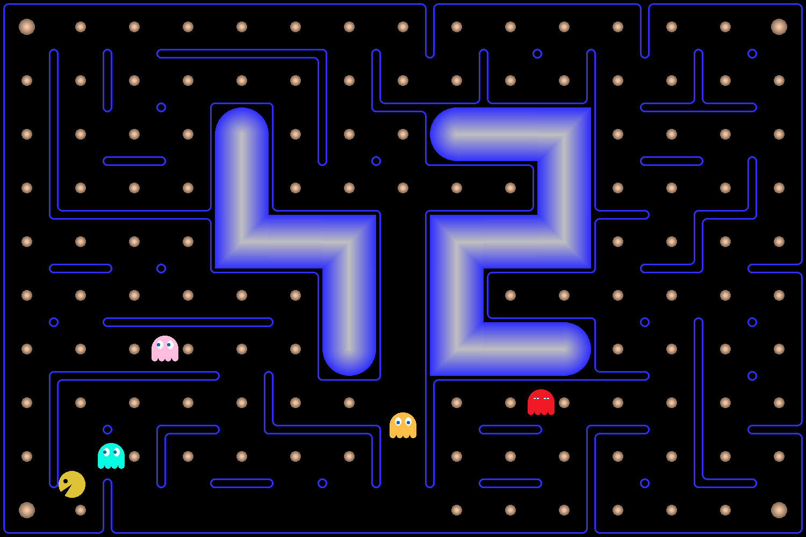
</p>

<a id="maze_generation.a_maze_ing_package"></a>

## **$${\color{violet}5.1. \space A-Maze-ing \space Package}$$**

The maze generator is supplied with the assignment and must not be modified. The project uses its assigned **A-Maze-ing** package, provided as a wheel in `packages/`. The program imports it and uses its data to build the Pac-Man maze. The package must remain reinstallable without modification during the evaluation.

<a id="maze_generation.integration_and_settings"></a>

## **$${\color{violet}5.2. \space Integration \space and \space Settings}$$**

The adapter lives in `engine/maze.py`. It sets dimensions, seed, and the required parameters, then calls the generator with `perfect=False`, as required. The assigned package exposes neither arguments to `generate()` nor public setters for every required value: the adapter therefore updates the corresponding internal attributes **without modifying the package's code**. This integration was tested with the assigned version.

<a id="maze_generation.geometry_and_navigation"></a>

## **$${\color{violet}5.3. \space Geometry \space and \space Navigation}$$**

The `Maze` module exposes operations used by the rest of the game: checking whether a cell is available, allowed directions, movement, pathfinding, reachable-cell searches, and controlled wall destruction. The game engine therefore does not need to manipulate the generator's internal representation for every move.

<a id="maze_generation.reproducibility_and_errors"></a>

## **$${\color{violet}5.4. \space Reproducibility \space and \space Errors}$$**

The configured seed is used for the first level; later levels use variable generation. Configuration and generation errors are handled by dedicated layers. This README describes the adapter's logic; the exact version of the assigned wheel remains the reference for its interface.

$${\color{teal}⋘⊛⋙}$$
<a id="game_mechanics"></a>

# **$${\color{orange}6. \space Game \space Mechanics}$$**

<details><summary><strong>Section contents 🗂️</strong></summary>

- [6.1. Pac-Man and Movement](#game_mechanics.pac_man_and_moves)
- [6.2. Ghosts and Behaviors](#game_mechanics.ghosts_and_behaviors)
- [6.3. Pacgums and Scoring](#game_mechanics.pacgums_and_score)
- [6.4. Lives, Time and Collisions](#game_mechanics.lives_time_and_collisions)

</details>

# [◀️](#maze_generation)&nbsp;&nbsp;&nbsp;[⏫](#top)&nbsp;&nbsp;&nbsp;[▶️](#controls)

<a id="game_mechanics.pac_man_and_moves"></a>

## **$${\color{violet}6.1. \space Pac-Man \space and \space Movement}$$**

Movement is handled by `engine/player.py`, `game/controls.py`, and `engine/physics.py`. Pac-Man moves through corridors and collides with walls unless an appropriate cheat is explicitly enabled. Movement and gameplay effects are separate from their graphical representation.

<a id="game_mechanics.ghosts_and_behaviors"></a>

## **$${\color{violet}6.2. \space Ghosts \space and \space Behaviors}$$**

`engine/ghosts.py` manages autonomous opponents. Their behavior depends on their state: dangerous normally, vulnerable after a super-pacgum, and able to flee from Pac-Man. After being eaten, they become intangible and harmless until they return to their starting position and recover their normal state and behavior. Pursuit and navigation use maze information.

<a id="game_mechanics.pacgums_and_score"></a>

## **$${\color{violet}6.3. \space Pacgums \space and \space Scoring}$$**

Ordinary pacgums and super-pacgums are managed by `engine/pacgums.py`. Their default point values are **10** and **50**, respectively; eating a ghost awards **200** points by default. Other bonuses are also available.\
The engine distinguishes collection events, their effects, associated sounds, and counter updates.\
When the `Gumcharmer` cheat is enabled, pacgums become mobile.

<a id="game_mechanics.lives_time_and_collisions"></a>

## **$${\color{violet}6.4. \space Lives, \space Time \space and \space Collisions}$$**

The game starts with **3 lives** by default; this number is configurable. The player loses a life upon contact with a dangerous ghost, respawns, and continues while lives remain. The score is retained between levels.\
The default time limit is **90 seconds**; both the limit and its consequence are configurable (by default, ghosts speed up).

$${\color{teal}⋘⊛⋙}$$
<a id="controls"></a>

# **$${\color{orange}7. \space Controls}$$**

<details><summary><strong>Section contents 🗂️</strong></summary>

- [7.1. Keyboard](#controls.keyboard)
- [7.2. Mouse and Gamepad](#controls.mouse_and_gamepad)
- [7.3. Pause and Contextual Commands](#controls.pause_and_contextual_commands)

</details>

# [◀️](#game_mechanics)&nbsp;&nbsp;&nbsp;[⏫](#top)&nbsp;&nbsp;&nbsp;[▶️](#inventory)

<p align="center">
    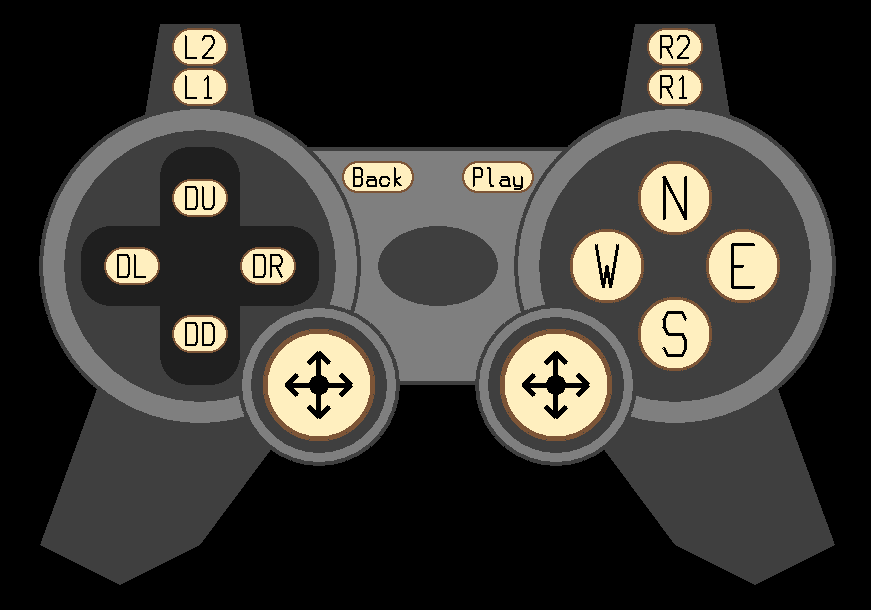
</p>

<a id="controls.keyboard"></a>

## **$${\color{violet}7.1. \space Keyboard}$$**

The game supports movement in all four directions using the keyboard. Arrow keys and common keyboard layouts are handled by the control system. Input management is centralized in `game/controls.py` and the interface components.

<a id="controls.mouse_and_gamepad"></a>

## **$${\color{violet}7.2. \space Mouse \space and \space Gamepad}$$**

Menus and certain interactions can also be controlled with a mouse or gamepad. Name entry uses a virtual keyboard accessible through the supported input devices. The project accounts for differences between AZERTY and QWERTY keyboards.

<a id="controls.pause_and_contextual_commands"></a>

## **$${\color{violet}7.3. \space Pause \space and \space Contextual \space Commands}$$**

The game can be paused and resumed. The pause menu provides the necessary options, including returning to the main menu and accessing the cheat menu if it has been unlocked. For exact key combinations and contextual actions, see the **in-game guide*, available through the main menu's `Guide` button.

$${\color{teal}⋘⊛⋙}$$
<a id="inventory"></a>

# **$${\color{orange}8. \space Inventory \space and \space Items}$$**

<details><summary><strong>Section contents 🗂️</strong></summary>

- [8.1. Design Philosophy](#inventory.philosophy)
- [8.2. Items and Effects](#inventory.objects_and_effects)
- [8.3. Interactions with the Game](#inventory.game_interactions)

</details>

# [◀️](#controls)&nbsp;&nbsp;&nbsp;[⏫](#top)&nbsp;&nbsp;&nbsp;[▶️](#cheat_mode)

<a id="inventory.philosophy"></a>

<p align="center">
    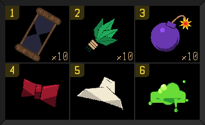
</p>

## **$${\color{violet}8.1. \space Design \space Philosophy}$$**

An inventory is not required by the assignment. It is an additional gameplay system centralized in `engine/inventory.py`. Items have associated states, effects, and interactions with the game. Their graphical representations are produced by `Shapes`.

<a id="inventory.objects_and_effects"></a>

## **$${\color{violet}8.2. \space Items \space and \space Effects}$$**

Item effects can temporarily change the player's or maze's situation. The engine separates their logic, availability, and display. Cheat options can also fill or empty the inventory, making testing easier without waiting for normal spawn conditions.

<a id="inventory.game_interactions"></a>

## **$${\color{violet}8.3. \space Interactions \space with \space the \space Game}$$**

Some items affect the environment, including the scenery and interactions with ghosts. Their use follows rules defined by the engine rather than allowing arbitrary, permanent changes to the maze.
- The Extra Life adds to the persistent life reserve
- The Hourglass swaps elapsed and remaining time
- The Sage repels ghosts without making them harmless
- The Bomb explodes after 3 seconds and kills any entity in the same row or column, up to the first wall encountered
- The Bow applies a Ms. Pac-Man theme
- The Stetson applies a Packy-Pake theme inspired by Lucky Luke
- The Slime applies a Ghostbusters theme

$${\color{teal}⋘⊛⋙}$$
<a id="cheat_mode"></a>

# **$${\color{orange}9. \space Cheat \space Mode}$$**

<details><summary><strong>Section contents 🗂️</strong></summary>

- [9.1. Access and Unlocking](#cheat_mode.access_and_unlocking)
- [9.2. Persistent Effects](#cheat_mode.persistent_effects)
- [9.3. One-Off Actions](#cheat_mode.punctual_actions)
- [9.4. Use During Evaluation](#cheat_mode.review_usage)

</details>

# [◀️](#inventory)&nbsp;&nbsp;&nbsp;[⏫](#top)&nbsp;&nbsp;&nbsp;[▶️](#mini_games)

<p align="center">
    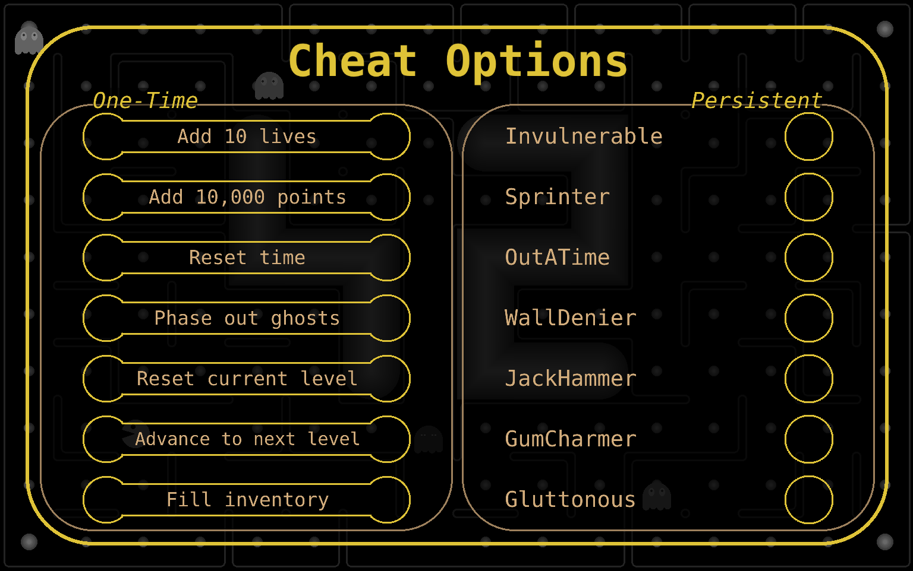
</p>

<a id="cheat_mode.access_and_unlocking"></a>

## **$${\color{violet}9.1. \space Access \space and \space Unlocking}$$**

Cheat mode is designed as a **demonstration and testing tool**, as required by the assignment. It is accessible from the interface and can be unlocked with a variant of the Konami code (`⇧⇧⇩⇩⇦⇨⇦⇨P`). The key between Escape and Tab, to the left of `1` *(`²` on AZERTY keyboards)*, can also open the interface when available.

<a id="cheat_mode.persistent_effects"></a>

## **$${\color{violet}9.2. \space Persistent \space Effects}$$**

Persistent effects include **Invulnerable**, **Sprinter**, **OutATime**, **WallDenier**, **JackHammer**, **GumCharmer**, and **Gluttonous**. Respectively, they prevent lost lives, speed up Pac-Man, freeze time and ghosts, allow movement through walls, destroy certain walls, attract pacgums, and make ghosts edible. Persistent effects are reset according to the end-of-level rules.

<a id="cheat_mode.punctual_actions"></a>

## **$${\color{violet}9.3. \space One-Off \space Actions}$$**

One-off commands can add or remove lives, change the score, reset the timer, restart or switch levels, change ghost danger states, and fill or empty the inventory. Available commands are defined in `engine/cheats.py` and shown in the dedicated menu.

<a id="cheat_mode.review_usage"></a>

## **$${\color{violet}9.4. \space Use \space During \space Evaluation}$$**

Evaluators can use these commands to reach a particular situation immediately: collisions, vulnerable ghosts, advanced levels, game over, or inventory interactions. Cheat mode avoids replaying long sequences just to verify a single feature.

$${\color{teal}⋘⊛⋙}$$
<a id="mini_games"></a>

# **$${\color{orange}10. \space Mini-Games}$$**

<details><summary><strong>Section contents 🗂️</strong></summary>

- [10.1. Shared Architecture](#mini_games.common_architecture)
- [10.2. Pac-Snake](#mini_games.pac_snake)
- [10.3. Pac-Breaker](#mini_games.pac_breaker)
- [10.4. Pac-Tris](#mini_games.pac_tris)
- [10.5. Pac-Invaders](#mini_games.pac_invaders)

</details>

# [◀️](#cheat_mode)&nbsp;&nbsp;&nbsp;[⏫](#top)&nbsp;&nbsp;&nbsp;[▶️](#user_interface)

<a id="mini_games.common_architecture"></a>

## **$${\color{violet}10.1. \space Shared \space Architecture}$$**

`minigames/minigames.py` provides a shared layer for launching games, updating them, displaying rules, managing board geometry, pausing, and returning to the main game. Each of the four mini-games has its own module, and its rules are shown when it starts. They share the project's graphics infrastructure and controls.

<a id="mini_games.pac_snake"></a>

## **$${\color{violet}10.2. \space Pac-Snake}$$**

<p align="center">
    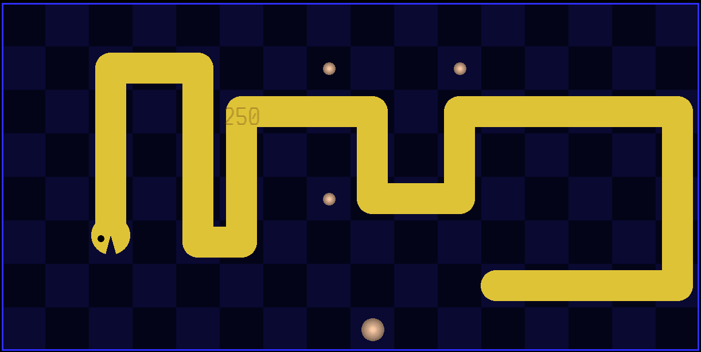
</p>

**Pac-Snake** (`snake.py`) brings the classic Snake concept into the project's visual universe. The module implements its own movement, progression, and collision logic.

<a id="mini_games.pac_breaker"></a>

## **$${\color{violet}10.3. \space Pac-Breaker}$$**

<p align="center">
    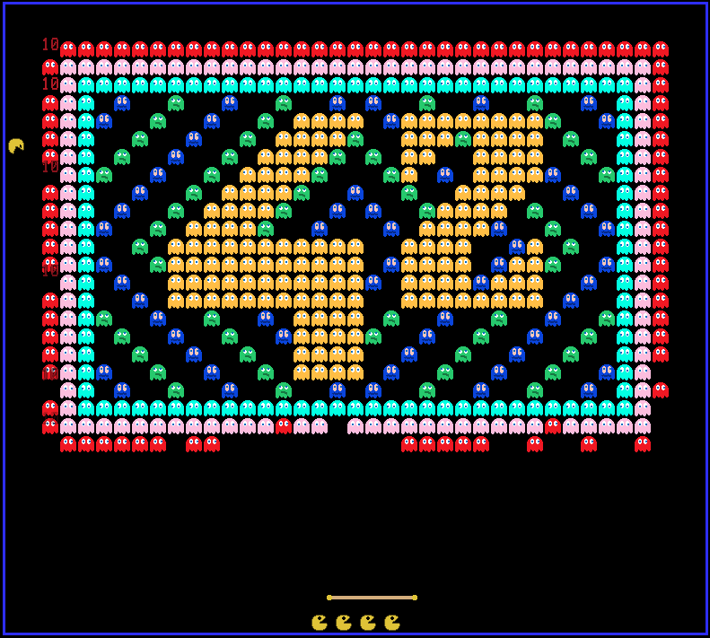
</p>

**Pac-Breaker** (`breaker.py`) adapts the brick-breaker concept with its own playfield, moving objects, and rules.

<a id="mini_games.pac_tris"></a>

## **$${\color{violet}10.4. \space Pac-Tris}$$**

<p align="center">
    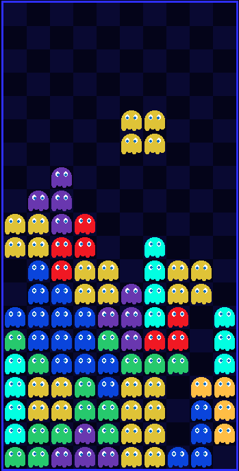
</p>

**Pac-Tris** (`tetris.py`) offers a variation on falling-block gameplay, with its own piece and playfield management.

<a id="mini_games.pac_invaders"></a>

## **$${\color{violet}10.5. \space Pac-Invaders}$$**

<p align="center">
    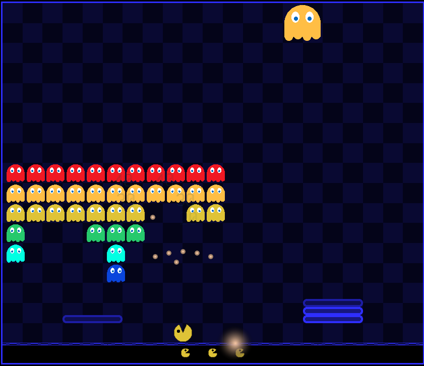
</p>

**Pac-Invaders** (`invaders.py`) uses the mechanics of a wave-based shooting game. Its engine is independent of the maze engine while reusing shared components.

$${\color{teal}⋘⊛⋙}$$
<a id="user_interface"></a>

# **$${\color{orange}11. \space User \space Interface}$$**

<details><summary><strong>Section contents 🗂️</strong></summary>

- [11.1. Main Menu](#user_interface.main_menu)
- [11.2. HUD and In-Game Menus](#user_interface.hud_and_game_menus)
- [11.3. Game Over and Name Entry](#user_interface.endgame_and_name_input)
- [11.4. Guide and Credits](#user_interface.guide_and_credits)

</details>

# [◀️](#mini_games)&nbsp;&nbsp;&nbsp;[⏫](#top)&nbsp;&nbsp;&nbsp;[▶️](#audio)

<a id="user_interface.main_menu"></a>

<p align="center">
    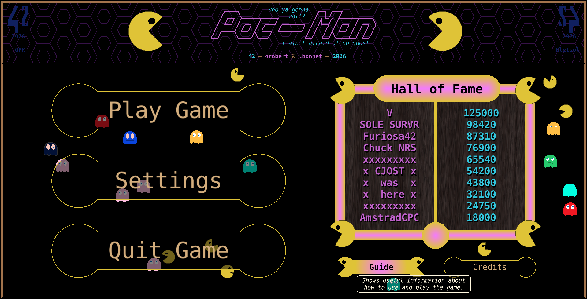
</p>

## **$${\color{violet}11.1. \space Main \space Menu}$$**

The main menu lets players start a game, view high scores, open help and settings, see the credits, and quit. Background animations and idle behavior enrich the welcome screen.

<a id="user_interface.hud_and_game_menus"></a>

## **$${\color{violet}11.2. \space HUD \space and \space In-Game \space Menus}$$**

The HUD shows essential information: score, remaining lives, level, time, and inventory. Pause, settings, and cheat menus are handled by separate modules so their interaction rules do not become entangled with the game board.

<a id="user_interface.endgame_and_name_input"></a>

## **$${\color{violet}11.3. \space Game \space Over \space and \space Name \space Entry}$$**

Victory and defeat screens show the outcome of a game. Players can enter a name for the rankings through an interface supporting keyboard, mouse, and gamepad. Animated transitions connect the different game states.

<a id="user_interface.guide_and_credits"></a>

## **$${\color{violet}11.4. \space Guide \space and \space Credits}$$**

The built-in guide presents controls and rules in the selected language, adapted to the user's keyboard. Credits and narrative interludes have dedicated screens.

$${\color{teal}⋘⊛⋙}$$
<a id="audio"></a>

# **$${\color{orange}12. \space Audio}$$**

<details><summary><strong>Section contents 🗂️</strong></summary>

- [12.1. Music and Sound Effects](#audio.musics_and_effects)
- [12.2. Audio Management](#audio.audio_management)
- [12.3. Assets](#audio.assets)

</details>

# [◀️](#user_interface)&nbsp;&nbsp;&nbsp;[⏫](#top)&nbsp;&nbsp;&nbsp;[▶️](#localization)

<a id="audio.musics_and_effects"></a>

## **$${\color{violet}12.1. \space Music \space and \space Sound \space Effects}$$**

The `engine/audio.py` module centralizes music and sound effects. Raylib provides playback functions; assets are stored in `pacman/assets/audio/`. The game uses WAV files for effects and MP3 files for music.

<a id="audio.audio_management"></a>

## **$${\color{violet}12.2. \space Audio \space Management}$$**

The configuration provides separate volumes: `master_volume`, `music_volume`, and `sound_volume`. The engine triggers effects in response to game events and manages music changes between screens and sequences.

<a id="audio.assets"></a>

## **$${\color{violet}12.3. \space Assets}$$**

Audio files are distributed as assets rather than generated by the shape engine. Audio performance and latency depend on the runtime environment; tests were conducted on Linux, both in a virtual machine and on native hardware.

$${\color{teal}⋘⊛⋙}$$
<a id="localization"></a>

# **$${\color{orange}13. \space Localization}$$**

<details><summary><strong>Section contents 🗂️</strong></summary>

- [13.1. Principle](#localization.principles)
- [13.2. Available Languages](#localization.available_languages)
- [13.3. Lexicon and Typography](#localization.lexicon_et_typography)
- [13.4. Keyboard Layout](#localization.keyboard_layout)

</details>

# [◀️](#audio)&nbsp;&nbsp;&nbsp;[⏫](#top)&nbsp;&nbsp;&nbsp;[▶️](#configuration)

<a id="localization.principles"></a>

## **$${\color{violet}13.1. \space Principle}$$**

Not all visible text is hard-coded in the modules: `Core.lexicon()` retrieves strings from language files. This separation simplifies translation, humorous variants, and maintenance of menus, the guide, and credits.

<a id="localization.available_languages"></a>

## **$${\color{violet}13.2. \space Available \space Languages}$$**

Language assets include **French, English, German, Breton, and Alsatian**, along with humorous **Froggies and Pirate** variants. JSON files are stored in `pacman/assets/languages/`. The subtitle **Escape from Flativerses** deliberately remains unchanged in every language.

<a id="localization.lexicon_et_typography"></a>

## **$${\color{violet}13.3. \space Lexicon \space and \space Typography}$$**

The engine normalizes certain typographic quotation marks and apostrophes for rendering, except when a string is requested in raw mode. Translations must preserve lexicon identifiers and any substitution parameters.

<a id="localization.keyboard_layout"></a>

## **$${\color{violet}13.4. \space Keyboard \space Layout}$$**

Wherever keys are displayed, the engine checks the active operating-system keyboard layout and shows the actual keys. AZERTY and QWERTY layouts are supported, and layouts can be changed on the fly.

$${\color{teal}⋘⊛⋙}$$
<a id="configuration"></a>

# **$${\color{orange}14. \space Configuration}$$**

<details><summary><strong>Section contents 🗂️</strong></summary>

- [14.1. Format and Loading](#configuration.format_and_loading)
- [14.2. General Settings](#configuration.general_settings)
- [14.3. Game Settings](#configuration.game_settings)
- [14.4. Levels](#configuration.levels)
- [14.5. Error Handling](#configuration.error_handling)
- [14.6. Settings Menu](#configuration.settings_menu)

</details>

# [◀️](#localization)&nbsp;&nbsp;&nbsp;[⏫](#top)&nbsp;&nbsp;&nbsp;[▶️](#highscores)

<p align="center">
    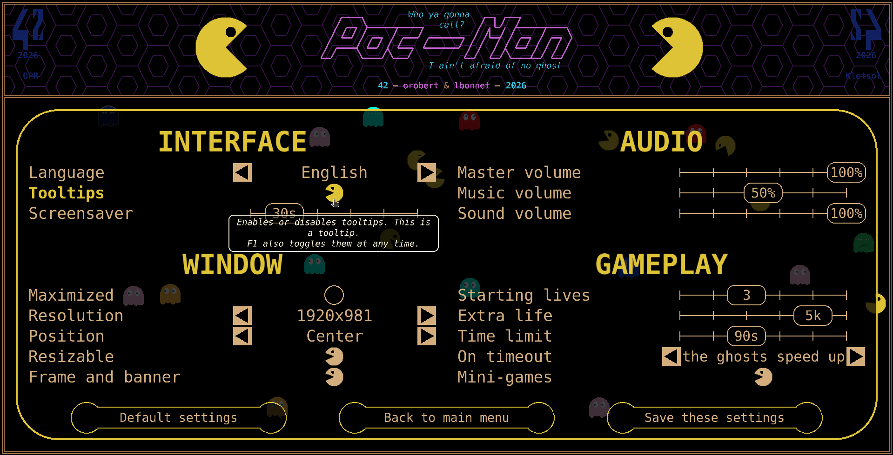
</p>

<a id="configuration.format_and_loading"></a>

## **$${\color{violet}14.1. \space Format \space and \space Loading}$$**

The program expects **exactly one argument**: the path to a `.json` file. The loader accepts comments on lines beginning with `#`. `ConfigManager` reads, validates, completes, and, when necessary, repairs the configuration; unknown keys are ignored. Missing or invalid values are replaced with safe defaults and reported without a traceback.

<a id="configuration.general_settings"></a>

## **$${\color{violet}14.2. \space General \space Settings}$$**

| Key | Supplied value | Purpose |
|---|---:|---|
| `data_dir` | `data` | Data directory |
| `highscore_filename` | `hall_of_fame.json` | High-score file |
| `window_width` / `window_height` | `1600` / `900` | Window dimensions |
| `window_resizable` | `true` | Resizable window |
| `window_maximized` | `true` | Start maximized |
| `window_position` | `topright` | Preferred position |
| `frame_and_banner` | `true` | Window frame and banner |
| `master_volume` | `100` | Master volume |
| `music_volume` | `50` | Music volume |
| `sound_volume` | `100` | Sound effects volume |
| `language` | `français` | Initial language |
| `hints` | `true` | Contextual hints |
| `hints_delay` | `0.5` | Hint delay |
| `disable_transitions` | `false` | Disable transitions |
| `minigames` | `true` | Enable mini-games |

<a id="configuration.game_settings"></a>

## **$${\color{violet}14.3. \space Game \space Settings}$$**

| Key | Supplied value | Purpose |
|---|---:|---|
| `lives` | `3` | Starting lives |
| `pts_pacgum` | `10` | Points per pacgum |
| `pts_super_pacgum` | `50` | Points per super-pacgum |
| `pts_ghost` | `200` | Points per ghost |
| `pts_bonus1` to `pts_bonus6` | `400` to `900` | Bonus point values |
| `new_life_threshold` | `5000` | Extra-life threshold |
| `level_max_time` | `90` | Initial level duration |
| `timeout_consequence` | `speeding_ghosts` | Time-limit consequence |
| `seed` | `42` | First-level seed |
| `main_menu_idle_time` | `30` | Menu idle delay |
| `main_menu_idle_visitor_min_time` | `30` | Minimum appearance delay |
| `main_menu_idle_visitor_max_time` | `60` | Maximum appearance delay |

<a id="configuration.levels"></a>

## **$${\color{violet}14.4. \space Levels}$$**

The `levels` array contains objects of the form `{ "width": ..., "height": ... }`. The supplied configuration has **12 entries**: `15×10`, `16×10`, `16×11`, `17×11`, `17×12`, `18×12`, `18×13`, `19×13`, `19×14`, `20×14`, `20×15`, and `21×15`. The loader checks dimensions and enforces safety limits.

<a id="configuration.error_handling"></a>

## **$${\color{violet}14.5. \space Error \space Handling}$$**

Validation is implemented in `base/config.py`. Invalid values are corrected and relevant events are logged. The program can back up a configuration before replacing an invalid file. Robustness and configuration tests were performed during development.

<a id="configuration.settings_menu"></a>

## **$${\color{violet}14.6. \space Settings \space Menu}$$**

Rather than editing the configuration file, it is more convenient to use the dedicated settings menu. It lets players adjust the most accessible game settings, restore defaults, and save their preferences. These then replace the values in the configuration file.\
A lighter settings menu is also available from the in-game pause menu.

$${\color{teal}⋘⊛⋙}$$
<a id="highscores"></a>

# **$${\color{orange}15. \space High \space Scores}$$**

<details><summary><strong>Section contents 🗂️</strong></summary>

- [15.1. Hall of Fame and Wall of Shame](#highscores.hall_of_fame_and_wall_of_shame)
- [15.2. Persistence](#highscores.persistence)
- [15.3. Validation and Integrity](#highscores.validation_and_integrity)

</details>

# [◀️](#configuration)&nbsp;&nbsp;&nbsp;[⏫](#top)&nbsp;&nbsp;&nbsp;[▶️](#instructions)

<p align="center">
    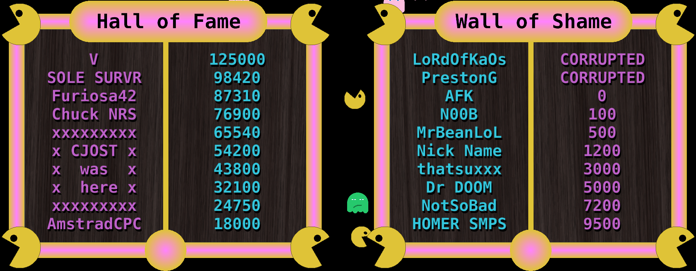
</p>

<a id="highscores.hall_of_fame_and_wall_of_shame"></a>

## **$${\color{violet}15.1. \space Hall \space of \space Fame \space and \space Wall \space of \space Shame}$$**

The project maintains two rankings: the **ten highest scores** (*Hall of Fame*) and the **ten lowest** (*Wall of Shame*). The interface lets players view and switch between them. The second ranking is an intentional addition beyond the assignment.

<a id="highscores.persistence"></a>

## **$${\color{violet}15.2. \space Persistence}$$**

`game/highscores.py` loads and saves scores in a JSON file. Each entry contains a name and a non-negative integer score. Names are limited to ten alphanumeric characters or spaces, as required by the assignment. The system handles missing or malformed files.

<a id="highscores.validation_and_integrity"></a>

## **$${\color{violet}15.3. \space Validation \space and \space Integrity}$$**

Signatures and checksums are used to detect alterations to the rankings. The mechanism aims to preserve integrity and detect accidental or trivial modifications; it is not a cryptographic security system against an attacker with access to the source code.

$${\color{teal}⋘⊛⋙}$$
<a id="instructions"></a>

# **$${\color{orange}16. \space Installation \space and \space Usage}$$**

<details><summary><strong>Section contents 🗂️</strong></summary>

- [16.1. Prerequisites](#instructions.prerequisites)
- [16.2. Installation](#instructions.installation)
- [16.3. Launching](#instructions.launch)
- [16.4. Makefile](#instructions.makefile)
- [16.5. Static Validation](#instructions.static_validation)

</details>

# [◀️](#highscores)&nbsp;&nbsp;&nbsp;[⏫](#top)&nbsp;&nbsp;&nbsp;[▶️](#packaging)

<a id="instructions.prerequisites"></a>

## **$${\color{violet}16.1. \space Prerequisites}$$**

The project requires **Python 3.10 or later**, a graphical Linux environment, and the dependencies listed in `pyproject.toml`. Installation with **uv** is recommended. Main dependencies are `pydantic`, `numpy`, `raylib`, and the assigned `mazegenerator` package. Development tools include `flake8`, `mypy`, `pytest`, and `pyinstaller`.

<a id="instructions.installation"></a>

## **$${\color{violet}16.2. \space Installation}$$**

From the repository root:
```bash
make install
```
or directly:
```bash
uv sync --dev
```
The assigned wheel is referenced in `pyproject.toml` under `packages/`. Do not modify it.

<a id="instructions.launch"></a>

## **$${\color{violet}16.3. \space Launching}$$**

Launch command required by the assignment:
```bash
python3 pac-man.py data/config.json
```
Or through the Makefile:
```bash
make run
make run_uv
```
The `run` target assumes dependencies are available in the active Python environment. `run_uv` runs them in the environment managed by uv.

<a id="instructions.makefile"></a>

## **$${\color{violet}16.4. \space Makefile}$$**

| Target | Purpose |
|---|---|
| `install` | Install dependencies |
| `run` / `run_uv` | Launch the game |
| `debug` / `debug_uv` | Run with debugger |
| `lint` / `lint-strict` | Check the code |
| `clean` / `fclean` | Clean temporary files |
| `build` | Build the distributable |
| `inventory` | Generate a project inventory |
Other targets provide development and maintenance utilities.

<a id="instructions.static_validation"></a>

## **$${\color{violet}16.5. \space Static \space Validation}$$**

Lint targets operate on `pacman/` and `pac-man.py` to avoid unnecessarily analyzing `.venv`. They use **flake8** and **mypy*, including a `lint-strict` target. Both ran without errors on the development version.
```bash
make lint
make lint-strict
```

$${\color{teal}⋘⊛⋙}$$
<a id="packaging"></a>

# **$${\color{orange}17. \space Distribution}$$**

<details><summary><strong>Section contents 🗂️</strong></summary>

- [17.1. Building](#packaging.construction)
- [17.2. Bundled Assets](#packaging.embedded_assets)
- [17.3. Publication](#packaging.publication)

</details>

# [◀️](#instructions)&nbsp;&nbsp;&nbsp;[⏫](#top)&nbsp;&nbsp;&nbsp;[▶️](#performance)

<a id="packaging.construction"></a>

## **$${\color{violet}17.1. \space Building}$$**

The project includes a `build` target based on **PyInstaller**. The Linux distribution package has been built and tested. The build script and settings must remain in the repository so it can be rebuilt during evaluation.

<a id="packaging.embedded_assets"></a>

## **$${\color{violet}17.2. \space Bundled \space Assets}$$**

Bundled assets include audio files, fonts, languages, the icon, and the shader. Frozen mode detects the PyInstaller environment and disables terminal display; the game's graphical logic remains active. Mutable data files, including high scores, must remain writable.

<a id="packaging.publication"></a>

## **$${\color{violet}17.3. \space Publication}$$**

The assignment requires free publication, possibly unlisted, on a game platform such as Itch.io. **The team will add the publication link once the game is uploaded.** A possible Windows version is a future option, not required for the initial submission.

$${\color{teal}⋘⊛⋙}$$
<a id="performance"></a>

# **$${\color{orange}18. \space Performance}$$**

<details><summary><strong>Section contents 🗂️</strong></summary>

- [18.1. Rendering and Caches](#performance.renderer_and_caching)
- [18.2. Update Organization](#performance.updates_organization)
- [18.3. Limits and Measurements](#performance.limits_and_measures)

</details>

# [◀️](#packaging)&nbsp;&nbsp;&nbsp;[⏫](#top)&nbsp;&nbsp;&nbsp;[▶️](#design_decisions)

<a id="performance.renderer_and_caching"></a>

## **$${\color{violet}18.1. \space Rendering \space and \space Caches}$$**

Recurring shapes are prepared and reused through the procedural texture cache. This separation avoids needlessly recalculating some complex drawings while preserving an MLX-compatible rendering path.

<a id="performance.updates_organization"></a>

## **$${\color{violet}18.2. \space Update \space Organization}$$**

The various engines separate state updates from display. Graphics rendering, game events, audio, and terminal output do not have exactly the same frequency requirements. The program has dedicated mechanisms for transitions and animations.

<a id="performance.limits_and_measures"></a>

## **$${\color{violet}18.3. \space Limits \space and \space Measurements}$$**

Despite its complexity beyond the assignment's requirements, this program runs at between 30 and 60 FPS, enough for smooth visuals and responsive controls. Tests were conducted in virtualized and native Linux environments.

$${\color{teal}⋘⊛⋙}$$
<a id="design_decisions"></a>

# **$${\color{orange}19. \space Design \space Decisions}$$**

<details><summary><strong>Section contents 🗂️</strong></summary>

- [19.1. Modular Architecture](#design_decisions.modular_architecture)
- [19.2. MLX-Compatible Rendering](#design_decisions.MLX_compatible_renderer)
- [19.3. Textures Rather Than Image Files](#design_decisions.textures_rather_than_image_files)
- [19.4. Gameplay Extensions](#design_decisions.gameplay_extension)

</details>

# [◀️](#performance)&nbsp;&nbsp;&nbsp;[⏫](#top)&nbsp;&nbsp;&nbsp;[▶️](#challenges)

<a id="design_decisions.modular_architecture"></a>

## **$${\color{violet}19.1. \space Modular \space Architecture}$$**

The project favors specialized modules over a single file. Subsystems share models and common orchestration while retaining distinct responsibilities. This structure facilitates targeted testing and feature additions.

<a id="design_decisions.MLX_compatible_renderer"></a>

## **$${\color{violet}19.2. \space MLX-Compatible \space Rendering}$$**

Raylib was chosen for robust window management, input, and audio. The educational MLX constraint led to a `Shapes` layer independent of advanced drawing functions, which can be enabled only as optional acceleration. This compromise demonstrates compliance without sacrificing optimizations.

<a id="design_decisions.textures_rather_than_image_files"></a>

## **$${\color{violet}19.3. \space Textures \space Rather \space Than \space Image \space Files}$$**

Textures are created at runtime rather than distributed as image files. This reduces the size of graphical assets, ensures a consistent aesthetic, and works as a cache of reusable renderings.

<a id="design_decisions.gameplay_extension"></a>

## **$${\color{violet}19.4. \space Gameplay \space Extensions}$$**

Inventory bonuses, mini-games, language variants, and the narrative universe are deliberate extensions. They were developed around the mandatory core rather than instead of it, using dedicated modules to contain their complexity.

$${\color{teal}⋘⊛⋙}$$
<a id="challenges"></a>

# **$${\color{orange}20. \space Challenges \space Encountered}$$**

<details><summary><strong>Section contents 🗂️</strong></summary>

- [20.1. Procedural Graphics](#challenges.procedural_graphics)
- [20.2. External Integration](#challenges.external_integration)
- [20.3. Audio and Environments](#challenges.audio_and_environments)
- [20.4. Growing Complexity](#challenges.increasing_complexity)

</details>

# [◀️](#design_decisions)&nbsp;&nbsp;&nbsp;[⏫](#top)&nbsp;&nbsp;&nbsp;[▶️](#bonus_features)

<a id="challenges.procedural_graphics"></a>

## **$${\color{violet}20.1. \space Procedural \space Graphics}$$**

Building complex shapes from elementary primitives requires particular attention to curves, outlines, angles, and gradients. The `Shapes` functions were developed to make these compositions reusable throughout the game.

<a id="challenges.external_integration"></a>

## **$${\color{violet}20.2. \space External \space Integration}$$**

The assigned generator's interface did not expose every necessary parameter. The adapter therefore had to prepare certain internal attributes before generation without modifying the package itself. This dependency on the assigned interface is documented to facilitate evaluation.

<a id="challenges.audio_and_environments"></a>

## **$${\color{violet}20.3. \space Audio \space and \space Environments}$$**

Virtualized and native Linux environments do not behave exactly alike for audio and graphics. Development required comparative tests, particularly around audio latency and keyboard input.

<a id="challenges.increasing_complexity"></a>

## **$${\color{violet}20.4. \space Growing \space Complexity}$$**

Bonus features gradually increased the number of modules and states to coordinate. Separating `engine`, `game`, `graphics`, and `minigames` is a response to this complexity, rather than an attempt to manage everything in one monolithic loop.

$${\color{teal}⋘⊛⋙}$$
<a id="bonus_features"></a>

# **$${\color{orange}21. \space Bonus \space Features}$$**

<details><summary><strong>Section contents 🗂️</strong></summary>

- [21.1. Beyond the Assignment](#bonus_features.beyond_the_subject)
- [21.2. Narrative and Universe](#bonus_features.narratives_and_universe)
- [21.3. Accessibility and Comfort](#bonus_features.accessibility_and_comfort)

</details>

# [◀️](#challenges)&nbsp;&nbsp;&nbsp;[⏫](#top)&nbsp;&nbsp;&nbsp;[▶️](#project_management)

<a id="bonus_features.beyond_the_subject"></a>

## **$${\color{violet}21.1. \space Beyond \space the \space Assignment}$$**

Extensions include four mini-games, an inventory, special items, additional cheat effects, elaborate menus and animations, and separate rankings for the highest and lowest scores.

<a id="bonus_features.narratives_and_universe"></a>

## **$${\color{violet}21.2. \space Narrative \space and \space Universe}$$**

Interludes and narrative texts give the project its own identity. The universe refers in particular to the Gospel of Pac-Amama and Pac-Man's journal, whose chronology is based on the game's historical release date, **May 22, 1980**.

<a id="bonus_features.accessibility_and_comfort"></a>

## **$${\color{violet}21.3. \space Accessibility \space and \space Comfort}$$**

The game offers several control methods, display and audio settings, contextual hints, extensive localization, and ways to demonstrate features quickly. Many of these options exceed the assignment's minimum requirements.

$${\color{teal}⋘⊛⋙}$$
<a id="project_management"></a>

# **$${\color{orange}22. \space Project \space Management}$$**

<details><summary><strong>Section contents 🗂️</strong></summary>

- [22.1. Team Organization](#project_management.pair_organisation)
- [22.2. Documents and Tracking](#project_management.documents_and_follow_up)
- [22.3. Acceptance Testing](#project_management.acceptance_tests)

</details>

# [◀️](#bonus_features)&nbsp;&nbsp;&nbsp;[⏫](#top)&nbsp;&nbsp;&nbsp;[▶️](#resources)

<a id="project_management.pair_organisation"></a>

## **$${\color{violet}22.1. \space Team \space Organization}$$**

The project was developed jointly by **orobert** and **lbonnet**. orobert worked primarily on graphics rendering, maze adaptation, mini-games, and the narrative universe; lbonnet focused on project management, the distributable, testing, and bug hunting. Ideas and decisions were discussed together.

<a id="project_management.documents_and_follow_up"></a>

## **$${\color{violet}22.2. \space Documents \space and \space Tracking}$$**

Tracking documents are collected in [`project_management/`](project_management/) :
- `Project analysis.md`: technical choices and organization;
- `Risks_analysis.md`: risk analysis;
- `Acceptance test plan.md`: test plan and fixes.
They provide a reference for the decisions, difficulties, and checks carried out.

<a id="project_management.acceptance_tests"></a>

## **$${\color{violet}22.3. \space Acceptance \space Testing}$$**

Tests were carried out by the authors and other students. On-campus testing was primarily conducted by lbonnet. Results and fixed bugs are detailed in the acceptance test plan; this README is not intended to reproduce that entire log.

$${\color{teal}⋘⊛⋙}$$
<a id="resources"></a>

# **$${\color{orange}23. \space Resources}$$**

<details><summary><strong>Section contents 🗂️</strong></summary>

- [23.1. Documentation](#resources.documentation)
- [23.2. Dependencies and Tools](#resources.tools_and_dependencies)
- [23.3. Artistic Resources](#resources.art_resources)

</details>

# [◀️](#project_management)&nbsp;&nbsp;&nbsp;[⏫](#top)&nbsp;&nbsp;&nbsp;[▶️](#ai_usage)

<a id="resources.documentation"></a>

## **$${\color{violet}23.1. \space Documentation}$$**

The main technical references are the official Python documentation, PEP 8 and PEP 257 guidelines, **Raylib** documentation, **PyInstaller** documentation, **uv** documentation, and the rules and specifications of 42's Pacman project. Documentation for the assigned A-Maze-ing generator complements these references.

Historical information about Pac-Man and the other mini-games was also consulted:
- [Pac-Man Wiki](https://pacman.fandom.com/wiki/Pac-Man_Wiki)
- [The Psychology of Snake](https://theoriginalsnake.com/blog/psychology-of-snake)
- [The story of Breakout](https://www.denofgeek.com/games/the-story-of-breakout/)
- [The History of Tetris](https://tetris.com/news/the-history-of-tetris)
- [Play Guide for Space Invaders](https://classicgaming.cc/classics/space-invaders/play-guide)

<a id="resources.tools_and_dependencies"></a>

## **$${\color{violet}23.2. \space Dependencies \space and \space Tools}$$**

| Component | Usage |
|---|---|
| Python 3.10+ | Language and standard library |
| Raylib / pyray | Window, input, audio, and rendering support |
| Pydantic | Models and validation |
| A-Maze-ing | External maze generation |
| uv | Environment and dependency management |
| flake8 / mypy | Static checks |
| PyInstaller | Build the distributable |

<a id="resources.art_resources"></a>

## **$${\color{violet}23.3. \space Artistic \space Resources}$$**

Bundled assets include audio files, fonts, translations, an icon, and a shader. Although the musical artists did not respond to the request to use their works, they are credited in the game's credits.

- [Pacman Theme Song 2026 by Trap Music Now](https://www.youtube.com/watch?v=DKzklEBZAa4)
- [Pacman Dubstep Remix by GokuSaiyajin](https://www.youtube.com/watch?v=mR0GTrIfEjw)
- [Pac-Man Remix Remastered by Multiversal Music](https://www.youtube.com/watch?v=XsYc9Xv6oMY)
- [Pac-Man Theme Remix by Arsenic 1987](https://www.youtube.com/watch?v=qtZ0hl-unM4)

$${\color{teal}⋘⊛⋙}$$
<a id="ai_usage"></a>

# **$${\color{orange}24. \space AI \space Usage}$$**

<details><summary><strong>Section contents 🗂️</strong></summary>

- [24.1. Scope](#ai_usage.perimeter)
- [24.2. Verification Methods](#ai_usage.verification_methods)
- [24.3. Authors’ Responsibility](#ai_usage.authors_responsibility)

</details>

# [◀️](#resources)&nbsp;&nbsp;&nbsp;[⏫](#top)&nbsp;&nbsp;&nbsp;[▶️](#final_thoughts)

<a id="ai_usage.perimeter"></a>

## **$${\color{violet}24.1. \space Scope}$$**

AI tools were used as **development and documentation assistants**: exploring ideas, discussing architectural choices, debugging support, translating and revising text, preparing tests, and writing documentation. Using AI does not relieve the authors of the responsibility to understand, verify, and stand behind every part of the project.

<a id="ai_usage.verification_methods"></a>

## **$${\color{violet}24.2. \space Verification \space Methods}$$**

Suggestions were checked against the actual code, assignment constraints, and tests. Sensitive mechanisms, including MLX-compatible rendering, the external generator, invalid configurations, and the distributable, underwent specific checks. Translations are reviewed with their linguistic particularities in mind.

<a id="ai_usage.authors_responsibility"></a>

## **$${\color{violet}24.3. \space Authors’ \space Responsibility}$$**

Design, integration, testing, and final decisions remain the responsibility of **orobert** and **lbonnet**.

$${\color{teal}⋘⊛⋙}$$
<a id="final_thoughts"></a>

# **$${\color{orange}25. \space Final \space Thoughts}$$**

<details><summary><strong>Section contents 🗂️</strong></summary>

- [25.1. Results](#final_thoughts.results)
- [25.2. Future Prospects](#final_thoughts.perspectives)

</details>

# [◀️](#ai_usage)&nbsp;&nbsp;&nbsp;[⏫](#top)&nbsp;&nbsp;&nbsp;[▶️](#contributors)

<a id="final_thoughts.results"></a>

## **$${\color{violet}25.1. \space Results}$$**

The project meets the expected mechanics of a multi-level Pac-Man game and gradually grew into a game with many additional systems. Its technical value lies as much in the gameplay as in procedural graphics composition, modular organization, and validation tools.

<a id="final_thoughts.perspectives"></a>

## **$${\color{violet}25.2. \space Future \space Prospects}$$**

A Windows port may be explored later but is not part of the initial delivery scope.\
The future projects mentioned in the credits are unlikely ever to see the light of day. We apologize for this.

$${\color{teal}⋘⊛⋙}$$
<a id="contributors"></a>

# **$${\color{orange}26. \space Contributors}$$**
# [◀️](#final_thoughts)&nbsp;&nbsp;&nbsp;[⏫](#top)&nbsp;&nbsp;&nbsp;[▶️](#bottom)

- **orobert** aka **OPR**\
    _Game development, graphics rendering, generator adaptation, mini-games, narrative universe, and overall integration_
- **lbonnet** aka **Kletsol**\
    _Project management, distributable preparation and testing, acceptance tests, bug hunting and fixes, contribution to decisions and improvements_
- **Testers**\
    _Enthusiastic feedback and bug reports_
- **ChatGPT**\
    _Explanations of mechanisms, debugging, suggestions_
- **Students** at **42 Mulhouse**\
    _Discussions, coffee, and moral support_

$${\color{teal}⋘⊛⋙}$$
<a id="bottom"></a>

# **$${\color{yellow}Thank \space you \space for \space your \space time}$$**

<p align="center">
    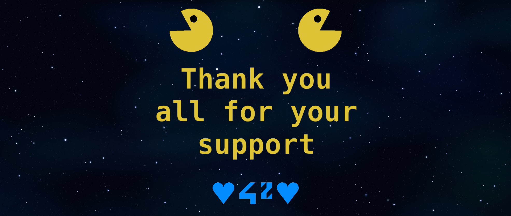
</p>

$${\color{teal}⋘⊛⋙}$$

###### $${\color{darkgrey}_i\space_f\space\space\space_y\space_o\space_u\space\space\space_c\space_a\space_n\space\space\space_r\space_e\space_a\space_d\space\space\space_t\space_h\space_i\space_s\space_,\space\space\space_y\space_o\space_u\space\space\space_d\space_o\space_n\space_`\space_t\space\space\space_n\space_e\space_e\space_d\space\space\space_g\space_l\space_a\space_s\space_s\space_e\space_s}$$
