_This project has been created as part of the 42 curriculum by **orobert** and **lbonnet**._
<a id="top"></a>

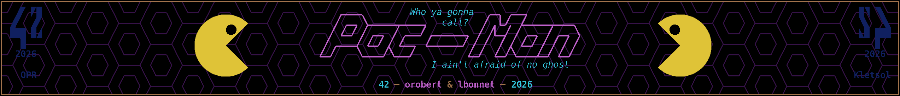

<h1 align="center">
  Pac-Man
  <br>
  Escape from Flativerses
</h1>

> **Ghosts! More ghosts!** — Une réinterprétation de Pac-Man, un moteur graphique procédural et quelques surprises qui ont pris un peu plus de place que prévu.

$${\color{teal}⋘⊛⋙}$$

# **$${\color{orange}Table \space des \space matières}$$**

- [1. Description](#description)
- [2. Présentation du jeu](#game_overview)
- [3. Architecture logicielle](#software_architecture)
- [4. Moteur graphique](#graphics_engine)
- [5. Génération des labyrinthes](#maze_generation)
- [6. Mécaniques de jeu](#game_mechanics)
- [7. Contrôles](#controls)
- [8. Inventaire et objets](#inventory)
- [9. Mode triche](#cheat_mode)
- [10. Mini-jeux](#mini_games)
- [11. Interface utilisateur](#user_interface)
- [12. Audio](#audio)
- [13. Localisation](#localization)
- [14. Configuration](#configuration)
- [15. Highscores](#highscores)
- [16. Installation et utilisation](#instructions)
- [17. Distribution](#packaging)
- [18. Performances](#performance)
- [19. Choix de conception](#design_decisions)
- [20. Difficultés rencontrées](#challenges)
- [21. Fonctionnalités bonus](#bonus_features)
- [22. Gestion de projet](#project_management)
- [23. Ressources](#resources)
- [24. Utilisation de l’IA](#ai_usage)
- [25. Bilan](#final_thoughts)
- [26. Contributeurs](#contributors)

$${\color{teal}⋘⊛⋙}$$
<a id="description"></a>

# **$${\color{orange}1. \space Description}$$**

<details><summary><strong>Sommaire de la section 🗂️</strong></summary>

- [1.1. Contexte](#description.context)
- [1.2. Objectifs](#description.objectives)
- [1.3. Périmètre du projet](#description.project_perimeter)

</details>

# [◀️](#top)&nbsp;&nbsp;&nbsp;[⏫](#top)&nbsp;&nbsp;&nbsp;[▶️](#game_overview)

<a id="description.context"></a>

<p align="center">
  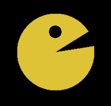
</p>

## **$${\color{violet}1.1. \space Contexte}$$**

Pac-Man, créé par Namco en 1980, repose sur une idée immédiatement compréhensible : parcourir un labyrinthe, collecter des pacgums et éviter quatre fantômes. Le projet **Pacman** de l’école 42 demande d’en proposer une nouvelle implémentation en Python, à partir de labyrinthes générés par un paquet externe, avec une interface graphique, des paramètres personnalisables et des scores persistants.

<a id="description.objectives"></a>

## **$${\color{violet}1.2. \space Objectifs}$$**

**Escape from Flativerses** reprend ce socle et le transforme en un jeu plus vaste : menus animés, progression multi-niveaux, système d’inventaire, objets interactifs, modes de triche, mini-jeux, séquences narratives, musique et localisation. Le but reste de préserver les règles immédiatement reconnaissables du jeu d’arcade tout en explorant des possibilités techniques et ludiques supplémentaires.

<a id="description.project_perimeter"></a>

## **$${\color{violet}1.3. \space Périmètre \space du \space projet}$$**

Le programme a été développé en **Python 3.10+** selon une architecture orientée objet. Il utilise **Raylib** via son interface Python pour la fenêtre, les entrées et l’audio. Le dessin est organisé autour d’un moteur de primitives, avec un mode de rendu explicitement compatible avec les capacités graphiques de la MLX. Le projet est livré avec un `Makefile`, un fichier de configuration JSON et des documents de gestion de projet.

$${\color{teal}⋘⊛⋙}$$
<a id="game_overview"></a>

# **$${\color{orange}2. \space Présentation \space du \space jeu}$$**

<details><summary><strong>Sommaire de la section 🗂️</strong></summary>

- [2.1. Boucle de jeu](#game_overview.game_loop)
- [2.2. Niveaux et progression](#game_overview.levels_and_progression)
- [2.3. Fonctionnalités supplémentaires](#game_overview.additional_features)

</details>

# [◀️](#description)&nbsp;&nbsp;&nbsp;[⏫](#top)&nbsp;&nbsp;&nbsp;[▶️](#software_architecture)

<p align="center">
  
</p>

<a id="game_overview.game_loop"></a>

## **$${\color{violet}2.1. \space Boucle \space de \space jeu}$$**

La boucle principale suit le sujet : **menu principal → partie → victoire ou défaite → saisie du nom → scores → retour au menu**. Le joueur contrôle Pac-Man dans un labyrinthe, collecte les pacgums, évite les fantômes ou les mange temporairement après une super-pacgum. Une partie peut être mise en pause, reprise ou interrompue depuis l’interface.

<a id="game_overview.levels_and_progression"></a>

## **$${\color{violet}2.2. \space Niveaux \space et \space progression}$$**

La configuration fournie définit **12 niveaux**, dépassant le minimum de dix. Le premier utilise une graine fixée pour être reproductible ; les suivants sont générés avec de nouvelles graines. Les dimensions augmentent progressivement, de **15 × 10** à **21 × 15**. Le score et les vies restantes accompagnent le joueur entre les niveaux. La limite de temps par défaut est de **90 secondes** par niveau, avec une conséquence configurable à son expiration.

<a id="game_overview.additional_features"></a>

## **$${\color{violet}2.3. \space Fonctionnalités \space supplémentaires}$$**

Le jeu propose notamment quatre mini-jeux, un inventaire, des animations de transition, un univers narratif et plusieurs langues. Ces extensions ne remplacent pas les exigences de Pac-Man : elles les entourent d’une expérience plus large. Le mode de triche permet de tester rapidement les différentes situations pendant une évaluation.

$${\color{teal}⋘⊛⋙}$$
<a id="software_architecture"></a>

# **$${\color{orange}3. \space Architecture \space logicielle}$$**

<details><summary><strong>Sommaire de la section 🗂️</strong></summary>

- [3.1. Cycle de vie de l’application](#software_architecture.application_life_cycle)
- [3.2. Vue générale](#software_architecture.overview)
- [3.3. Arborescence](#software_architecture.arborescence)

</details>

# [◀️](#game_overview)&nbsp;&nbsp;&nbsp;[⏫](#top)&nbsp;&nbsp;&nbsp;[▶️](#graphics_engine)

<a id="software_architecture.application_life_cycle"></a>

## **$${\color{violet}3.1. \space Cycle \space de \space vie \space de \space l’application}$$**

Le point d’entrée `pac-man.py` valide l’argument de configuration, crée `Core`, lance l’application puis restaure l’état du terminal lors de la sortie. `Core` est le point d’assemblage des sous-systèmes : configuration, langue, terminal, jeu, graphique et gestion des événements.

<a id="software_architecture.overview"></a>

## **$${\color{violet}3.2. \space Vue \space générale}$$**

```text
pac-man.py
    │
    ▼
  Core ──────────── ConfigManager / Defaults / Models
    │
    ├── Game ────── Player / Ghosts / Physics / Pacgums / Maze
    │      ├─────── Inventory / Cheats / Audio / Transitions
    │      ├─────── HighScores / Interludes / Controls
    │      └─────── MiniGames ── Snake / Breaker / Tetris / Invaders
    │
    ├── Graphics ── Shapes / Textures / Menus / HUD / Board
    │      └─────── Animations / Window geometry
    │
    └── Dashboard ─ TerminalManager / Logbook / Canvas
```
*Cette représentation montre les responsabilités principales ; les interactions réelles entre modules sont plus nombreuses.*

<a id="software_architecture.arborescence"></a>

## **$${\color{violet}3.3. \space Arborescence}$$**

```text
pacman/
├── base/         Configuration, modèles, géométrie, utilitaires
├── dashboard/    Interface terminal, journaux, clavier terminal
├── engine/       Logique de jeu, labyrinthe, audio, inventaire
├── game/         Déroulement des parties, contrôles, scores
├── graphics/     Fenêtre, primitives, textures, menus, HUD
├── minigames/    Quatre jeux bonus et orchestration
├── assets/       Audio, polices, traductions, icône, shader
└── core.py       Assemblage des sous-systèmes
```
À la racine se trouvent notamment `pac-man.py`, `Makefile`, `pyproject.toml`, `uv.lock`, `data/`, `packages/`, `tools/` et `project_management/`.

$${\color{teal}⋘⊛⋙}$$
<a id="graphics_engine"></a>

# **$${\color{orange}4. \space Moteur \space graphique}$$**

<details><summary><strong>Sommaire de la section 🗂️</strong></summary>

- [4.1. Bibliothèque graphique et compatibilité MLX](#graphics_engine.graphics_lib_and_MLX_compatibility)
- [4.2. Primitives géométriques](#graphics_engine.geometric_primitives)
- [4.3. Textures procédurales et cache](#graphics_engine.procedural_textures_and_cache)
- [4.4. Animations et fenêtres](#graphics_engine.animations_and_windows)

</details>

# [◀️](#software_architecture)&nbsp;&nbsp;&nbsp;[⏫](#top)&nbsp;&nbsp;&nbsp;[▶️](#maze_generation)

<a id="graphics_engine.graphics_lib_and_MLX_compatibility"></a>

## **$${\color{violet}4.1. \space Bibliothèque \space graphique \space et \space compatibilité \space MLX}$$**

Le sujet autorise la MLX ou une bibliothèque équivalente, à condition que les fonctions graphiques employées possèdent des équivalents MLX. Raylib sert de support à l’application, mais les formes sont centralisées dans `graphics/shapes.py`. L’option `allow_raylib_shapes` *(dans la classe `Defaults` de `base/models.py`)* permet de désactiver les chemins accélérés et d’utiliser le rendu construit à partir de primitives compatibles MLX. **Ce mode a été testé indépendamment de l’accélération Raylib.** L’audio et les entrées ne constituent pas des primitives de dessin.

<a id="graphics_engine.geometric_primitives"></a>

## **$${\color{violet}4.2. \space Primitives \space géométriques}$$**

`Shapes` fournit les points, lignes, triangles, rectangles, cercles, secteurs, arcs, dégradés, textes et éléments graphiques du jeu. Les formes complexes sont construites par composition de formes élémentaires. On y trouve notamment les représentations de Pac-Man, des fantômes, des pacgums, des objets et des pictogrammes. La géométrie partagée est regroupée dans `base/geometry.py`.

<a id="graphics_engine.procedural_textures_and_cache"></a>

## **$${\color{violet}4.3. \space Textures \space procédurales \space et \space cache}$$**

Le projet **n’embarque pas de textures graphiques prérendues** : les textures utiles sont produites à l’exécution puis réutilisées via le module `graphics/textures.py`. Cette stratégie rapproche le moteur d’un système de cache d’images, réduit les ressources à distribuer et permet de conserver un rendu cohérent avec les primitives de base. Les fichiers de polices et l’icône constituent des ressources distinctes.

<a id="graphics_engine.animations_and_windows"></a>

## **$${\color{violet}4.4. \space Animations \space et \space fenêtres}$$**

`graphics/graphics.py` gère la fenêtre et la coordination du rendu. Les écrans sont répartis en modules dédiés : menu principal, aide, crédits, paramètres, plateau, HUD, victoire, saisie du score et menu de triche. Les animations et transitions sont isolées dans leurs propres composants. Certaines opérations de placement de fenêtre utilisent des informations X11 sous Linux.

$${\color{teal}⋘⊛⋙}$$
<a id="maze_generation"></a>

# **$${\color{orange}5. \space Génération \space des \space labyrinthes}$$**

<details><summary><strong>Sommaire de la section 🗂️</strong></summary>

- [5.1. Paquet A-Maze-ing](#maze_generation.a_maze_ing_package)
- [5.2. Intégration et paramètres](#maze_generation.integration_and_settings)
- [5.3. Géométrie et navigation](#maze_generation.geometry_and_navigation)
- [5.4. Reproductibilité et erreurs](#maze_generation.reproducibility_and_errors)

</details>

# [◀️](#graphics_engine)&nbsp;&nbsp;&nbsp;[⏫](#top)&nbsp;&nbsp;&nbsp;[▶️](#game_mechanics)

<p align="center">
  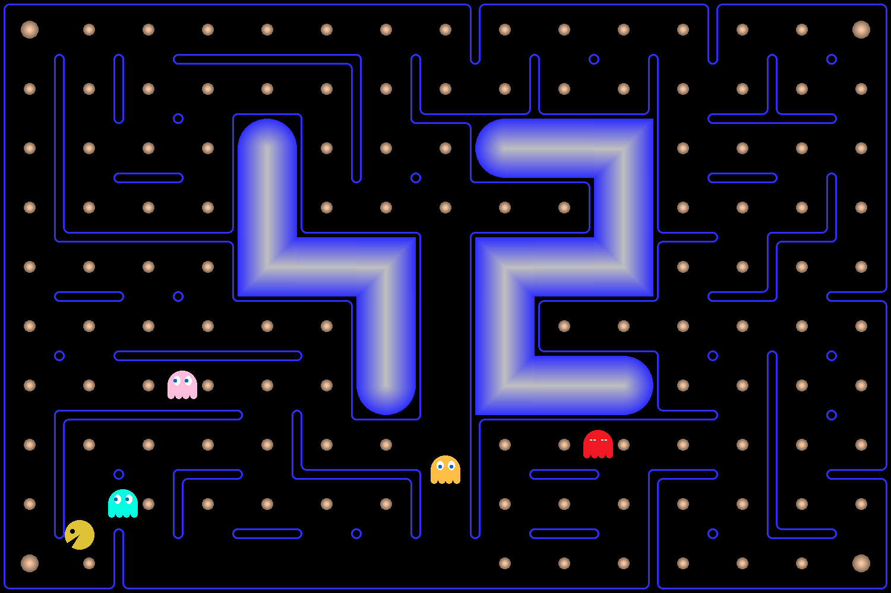
</p>

<a id="maze_generation.a_maze_ing_package"></a>

## **$${\color{violet}5.1. \space Paquet \space A-Maze-ing}$$**

Le générateur nous est fourni avec le sujet et ne doit pas être modifié. Le projet utilise le paquet **A-Maze-ing** attribué, livré ici sous forme de wheel dans `packages/`. Le programme l’importe et exploite ses données pour construire le labyrinthe Pac-Man. Le paquet doit pouvoir être réinstallé sans modification pendant la soutenance.

<a id="maze_generation.integration_and_settings"></a>

## **$${\color{violet}5.2. \space Intégration \space et \space paramètres}$$**

L’adaptateur se trouve dans `engine/maze.py`. Il renseigne les dimensions, la graine et les paramètres nécessaires, puis appelle le générateur avec `perfect=False`, conformément au sujet. Le paquet attribué ne fournit ni paramètres à `generate()` ni accesseurs publics pour toutes les valeurs requises : l’adaptateur met donc à jour les attributs internes correspondants **sans modifier le code du paquet**. Cette intégration a été testée avec la version attribuée.

<a id="maze_generation.geometry_and_navigation"></a>

## **$${\color{violet}5.3. \space Géométrie \space et \space navigation}$$**

Le module `Maze` expose les opérations utiles au reste du jeu : test de disponibilité d’une case, directions autorisées, déplacements, recherche de chemin, recherche de cases accessibles et destruction contrôlée de murs. Le moteur de jeu ne dépend donc pas directement de la représentation interne du générateur pour chaque déplacement.

<a id="maze_generation.reproducibility_and_errors"></a>

## **$${\color{violet}5.4. \space Reproductibilité \space et \space erreurs}$$**

La graine configurée sert au premier niveau ; les niveaux suivants utilisent une génération variable. Les erreurs de configuration et de génération sont traitées par les couches dédiées. Le README décrit ici la logique de l’adaptateur ; la version exacte du wheel attribué reste la référence pour son interface.

$${\color{teal}⋘⊛⋙}$$
<a id="game_mechanics"></a>

# **$${\color{orange}6. \space Mécaniques \space de \space jeu}$$**

<details><summary><strong>Sommaire de la section 🗂️</strong></summary>

- [6.1. Pac-Man et déplacements](#game_mechanics.pac_man_and_moves)
- [6.2. Fantômes et comportements](#game_mechanics.ghosts_and_behaviors)
- [6.3. Pacgums et score](#game_mechanics.pacgums_and_score)
- [6.4. Vies, temps et collisions](#game_mechanics.lives_time_and_collisions)

</details>

# [◀️](#maze_generation)&nbsp;&nbsp;&nbsp;[⏫](#top)&nbsp;&nbsp;&nbsp;[▶️](#controls)

<a id="game_mechanics.pac_man_and_moves"></a>

## **$${\color{violet}6.1. \space Pac-Man \space et \space déplacements}$$**

Les déplacements sont pilotés par `engine/player.py`, `game/controls.py` et `engine/physics.py`. Pac-Man se déplace dans les couloirs, avec des collisions contre les murs, sauf activation explicite d’une triche appropriée. Les mouvements et les effets de gameplay sont séparés de leur représentation graphique.

<a id="game_mechanics.ghosts_and_behaviors"></a>

## **$${\color{violet}6.2. \space Fantômes \space et \space comportements}$$**

`engine/ghosts.py` gère les adversaires autonomes. Leur comportement dépend notamment de leur état : dangereux en situation normale, vulnérables après une super-pacgum et susceptibles de fuir Pac-Man. Après avoir été mangés, ils perdent consistance et dangerosité jusqu'à être revenus à leur position de départ pour retrouver leur état et leur comportement normaux. La poursuite et la navigation utilisent les informations du labyrinthe.

<a id="game_mechanics.pacgums_and_score"></a>

## **$${\color{violet}6.3. \space Pacgums \space et \space score}$$**

Les pacgums ordinaires et les super-pacgums sont gérées par `engine/pacgums.py`. Leurs gains de points par défaut sont respectivement de **10** et **50** points ; un fantôme mangé rapporte par défaut **200** points. D'autres bonus sont également présents.
Le moteur distingue les événements de collecte, leurs effets, les sons associés et l’évolution des compteurs.\
Avec l'activation du mode de triche `Gumcharmer`, les pacgums deviennent mobiles.

<a id="game_mechanics.lives_time_and_collisions"></a>

## **$${\color{violet}6.4. \space Vies, \space temps \space et \space collisions}$$**

La partie démarre avec **3 vies** par défaut, cette quantité est configurable. Le joueur perd une vie au contact d’un fantôme dangereux, réapparaît et poursuit la partie tant qu’il lui reste des vies. Le score est conservé entre les niveaux.\
Le temps limite par défaut est de **90 secondes** ; il est configurable ainsi que sa conséquence (par défaut, les fantômes accélèrent).

$${\color{teal}⋘⊛⋙}$$
<a id="controls"></a>

# **$${\color{orange}7. \space Contrôles}$$**

<details><summary><strong>Sommaire de la section 🗂️</strong></summary>

- [7.1. Clavier](#controls.keyboard)
- [7.2. Souris et manette](#controls.mouse_and_gamepad)
- [7.3. Pause et commandes contextuelles](#controls.pause_and_contextual_commands)

</details>

# [◀️](#game_mechanics)&nbsp;&nbsp;&nbsp;[⏫](#top)&nbsp;&nbsp;&nbsp;[▶️](#inventory)

<p align="center">
  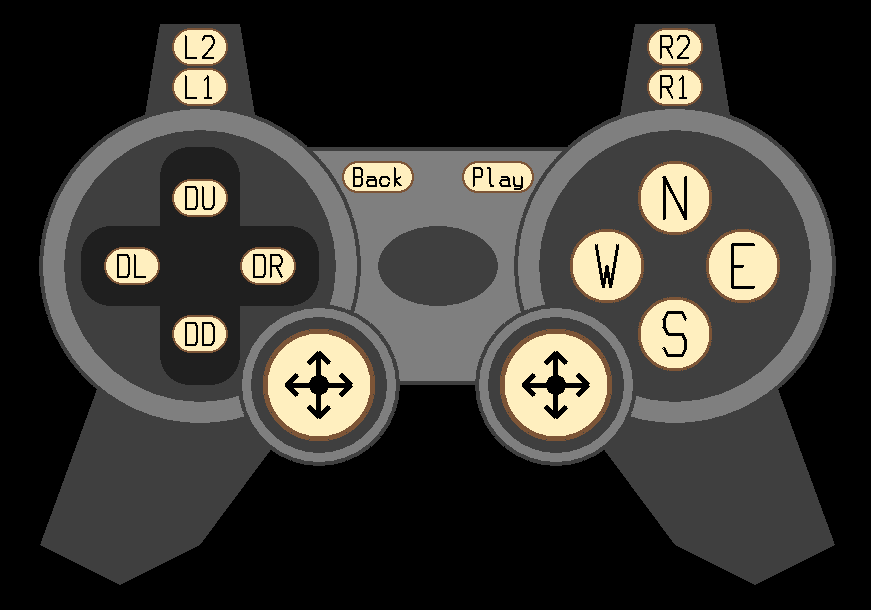
</p>

<a id="controls.keyboard"></a>

## **$${\color{violet}7.1. \space Clavier}$$**

Le jeu accepte les déplacements dans les quatre directions au clavier. Les touches de direction et les dispositions de clavier usuelles sont prises en compte par le système de contrôles. La gestion des entrées est centralisée dans `game/controls.py` et les composants d’interface.

<a id="controls.mouse_and_gamepad"></a>

## **$${\color{violet}7.2. \space Souris \space et \space manette}$$**

Les menus et certaines interactions peuvent également utiliser la souris et une manette. La saisie du nom repose sur un clavier virtuel, accessible par les dispositifs de contrôle prévus. Le projet tient compte des différences entre les claviers AZERTY et QWERTY.

<a id="controls.pause_and_contextual_commands"></a>

## **$${\color{violet}7.3. \space Pause \space et \space commandes \space contextuelles}$$**

Le jeu peut être mis en pause et repris. Le menu de pause donne accès aux options nécessaires, notamment le retour au menu principal l'éventuel menu de triche s'il a été déverrouillé. Pour les combinaisons exactes et les actions contextuelles, consulter le **guide intégré au jeu**, accessible par le bouton `Guide` du menu principal.

$${\color{teal}⋘⊛⋙}$$
<a id="inventory"></a>

# **$${\color{orange}8. \space Inventaire \space et \space objets}$$**

<details><summary><strong>Sommaire de la section 🗂️</strong></summary>

- [8.1. Philosophie](#inventory.philosophy)
- [8.2. Objets et effets](#inventory.objects_and_effects)
- [8.3. Interactions avec le labyrinthe](#inventory.game_interactions)

</details>

# [◀️](#controls)&nbsp;&nbsp;&nbsp;[⏫](#top)&nbsp;&nbsp;&nbsp;[▶️](#cheat_mode)

<a id="inventory.philosophy"></a>

<p align="center">
  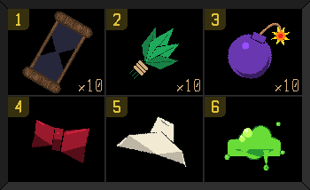
</p>

## **$${\color{violet}8.1. \space Philosophie}$$**

L’inventaire n’est pas exigé par le sujet. Il constitue un système supplémentaire de gameplay, centralisé dans `engine/inventory.py`. Les objets sont associés à des états, des effets et des interactions avec la partie. Les représentations graphiques sont produites par `Shapes`.

<a id="inventory.objects_and_effects"></a>

## **$${\color{violet}8.2. \space Objets \space et \space effets}$$**

Les effets des objets peuvent modifier temporairement la situation du joueur ou du labyrinthe. Le moteur sépare leur logique, leur disponibilité et leur affichage. Les options de triche permettent aussi de remplir ou de vider l’inventaire, ce qui facilite les essais sans devoir attendre les conditions normales d’apparition.

<a id="inventory.game_interactions"></a>

## **$${\color{violet}8.3. \space Interactions \space avec \space le \space jeu}$$**

Certains objets agissent sur l’environnement, notamment le décor ou les interactions avec les fantômes. Leur utilisation est soumise aux règles définies par le moteur, plutôt qu’à une modification libre et permanente du labyrinthe.
- La Vie s'ajoute à la réserve persistante
- Le Sablier inverse temps écoulé et temps restant
- La Sauge éloigne les fantômes tout en conservant leur dangerosité
- La Bombe explose après 3 secondes et tue toute entité à sa verticale et à son horizontale, jusqu'au premier mur rencontré
- Le Noeud applique un thème Ms. Pac-Man
- Le Stetson applique un thème Packy-Pake, inspiré de Lucky Luke
- La Gelée Gluante applique un thème Ghostbusters

$${\color{teal}⋘⊛⋙}$$
<a id="cheat_mode"></a>

# **$${\color{orange}9. \space Mode \space triche}$$**

<details><summary><strong>Sommaire de la section 🗂️</strong></summary>

- [9.1. Accès et déverrouillage](#cheat_mode.access_and_unlocking)
- [9.2. Effets persistants](#cheat_mode.persistent_effects)
- [9.3. Actions ponctuelles](#cheat_mode.punctual_actions)
- [9.4. Usage pendant la soutenance](#cheat_mode.review_usage)

</details>

# [◀️](#inventory)&nbsp;&nbsp;&nbsp;[⏫](#top)&nbsp;&nbsp;&nbsp;[▶️](#mini_games)

<p align="center">
  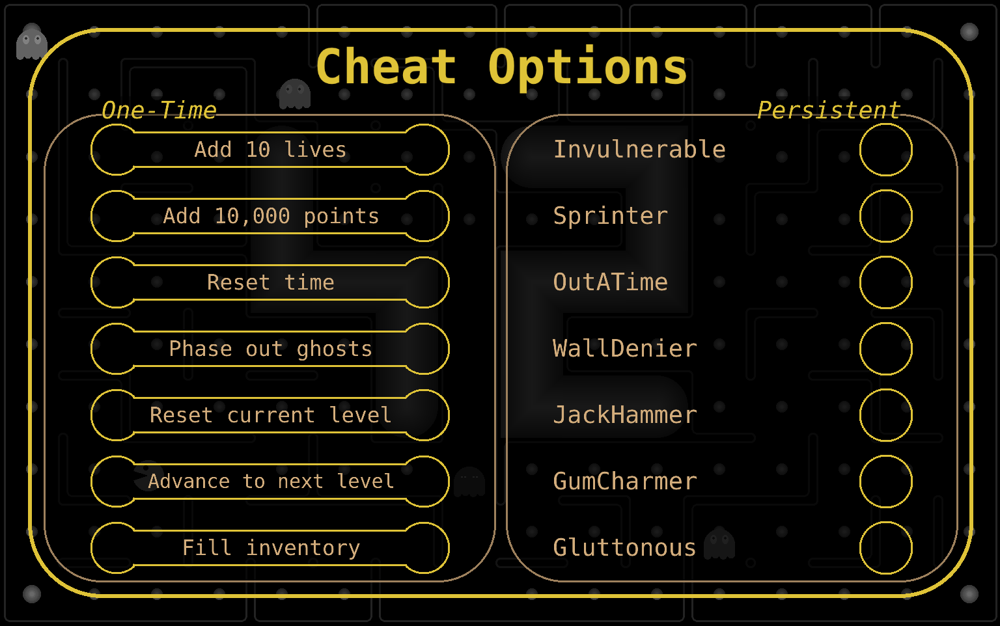
</p>

<a id="cheat_mode.access_and_unlocking"></a>

## **$${\color{violet}9.1. \space Accès \space et \space déverrouillage}$$**

Le mode triche est conçu comme un **outil de démonstration et de test**, conformément au sujet. Il est accessible depuis l’interface prévue et peut être déverrouillé par une variante du code Konami (`⇧⇧⇩⇩⇦⇨⇦⇨P`). La touche située entre Échap et Tab à gauche du `1` *(`²` en AZERTY)*, permet également d’ouvrir l’interface lorsqu’elle est disponible.

<a id="cheat_mode.persistent_effects"></a>

## **$${\color{violet}9.2. \space Effets \space persistants}$$**

Les effets persistants comprennent **Invulnerable**, **Sprinter**, **OutATime**, **WallDenier**, **JackHammer**, **GumCharmer** et **Gluttonous**. Ils permettent respectivement d’éviter les pertes de vie, d’accélérer Pac-Man, de figer le temps et les fantômes, de traverser les murs, de détruire certains murs, d’attirer les pacgums et de rendre les fantômes mangeables. Les effets persistants sont réinitialisés selon les règles de fin de niveau.

<a id="cheat_mode.punctual_actions"></a>

## **$${\color{violet}9.3. \space Actions \space ponctuelles}$$**

Les commandes ponctuelles permettent notamment d’ajouter ou de retirer des vies, de modifier le score, de réinitialiser le temps, de recommencer ou changer de niveau, d’agir sur la dangerosité des fantômes et de remplir ou vider l’inventaire. Les commandes disponibles sont définies dans `engine/cheats.py` et présentées par le menu dédié.

<a id="cheat_mode.review_usage"></a>

## **$${\color{violet}9.4. \space Usage \space pendant \space la \space soutenance}$$**

L’évaluateur peut utiliser ces commandes pour accéder immédiatement à une situation particulière : collisions, fantômes vulnérables, niveaux avancés, fin de partie ou interactions d’inventaire. Le mode triche évite de devoir rejouer de longues séquences pour vérifier une seule fonctionnalité.

$${\color{teal}⋘⊛⋙}$$
<a id="mini_games"></a>

# **$${\color{orange}10. \space Mini-jeux}$$**

<details><summary><strong>Sommaire de la section 🗂️</strong></summary>

- [10.1. Architecture commune](#mini_games.common_architecture)
- [10.2. Pac-Snake](#mini_games.pac_snake)
- [10.3. Pac-Breaker](#mini_games.pac_breaker)
- [10.4. Pac-Tris](#mini_games.pac_tris)
- [10.5. Pac-Invaders](#mini_games.pac_invaders)

</details>

# [◀️](#cheat_mode)&nbsp;&nbsp;&nbsp;[⏫](#top)&nbsp;&nbsp;&nbsp;[▶️](#user_interface)

<a id="mini_games.common_architecture"></a>

## **$${\color{violet}10.1. \space Architecture \space commune}$$**

`minigames/minigames.py` fournit une couche commune : lancement, mise à jour, affichage des règles, géométrie du plateau, pause et retour à la partie principale. Les quatre mini-jeux possèdent chacun leur module et leurs règles sont présentées lors de leur lancement. Ils partagent l’infrastructure graphique et les contrôles du projet.

<a id="mini_games.pac_snake"></a>

## **$${\color{violet}10.2. \space Pac-Snake}$$**

<p align="center">
  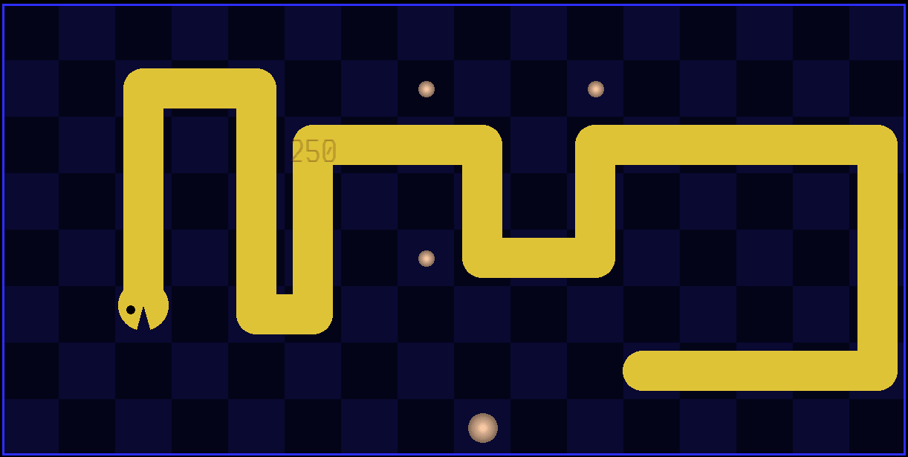
</p>

**Pac-Snake** (`snake.py`) transpose le principe du Snake dans l’univers graphique du projet. Le module contient sa propre logique de déplacement, de progression et de collisions.

<a id="mini_games.pac_breaker"></a>

## **$${\color{violet}10.3. \space Pac-Breaker}$$**

<p align="center">
  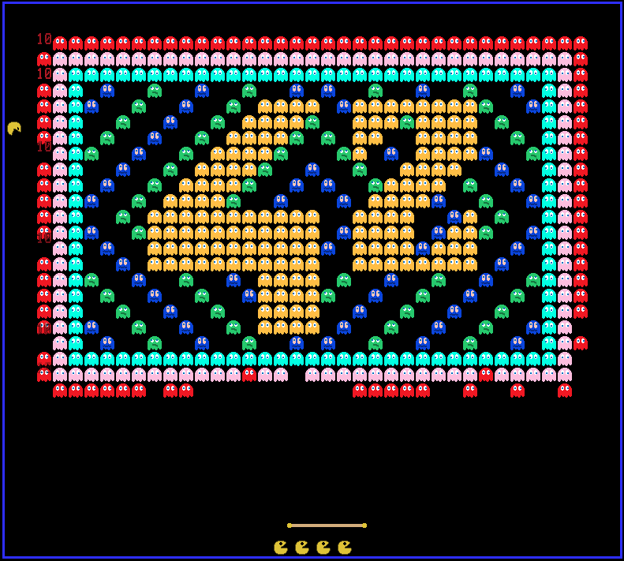
</p>

**Pac-Breaker** (`breaker.py`) reprend le principe du casse-briques, avec son plateau, ses objets mobiles et ses règles dédiées.

<a id="mini_games.pac_tris"></a>

## **$${\color{violet}10.4. \space Pac-Tris}$$**

<p align="center">
  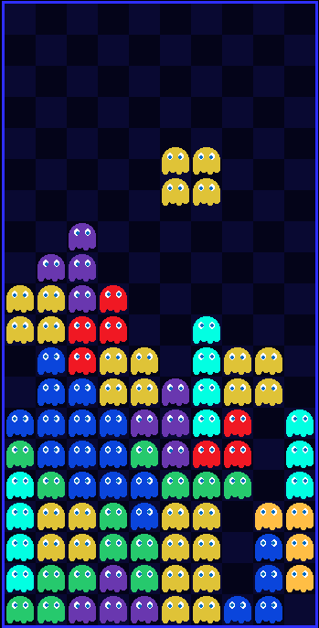
</p>

**Pac-Tris** (`tetris.py`) propose une variation du jeu de blocs tombants, avec une gestion propre des pièces et de l’aire de jeu.

<a id="mini_games.pac_invaders"></a>

## **$${\color{violet}10.5. \space Pac-Invaders}$$**

<p align="center">
  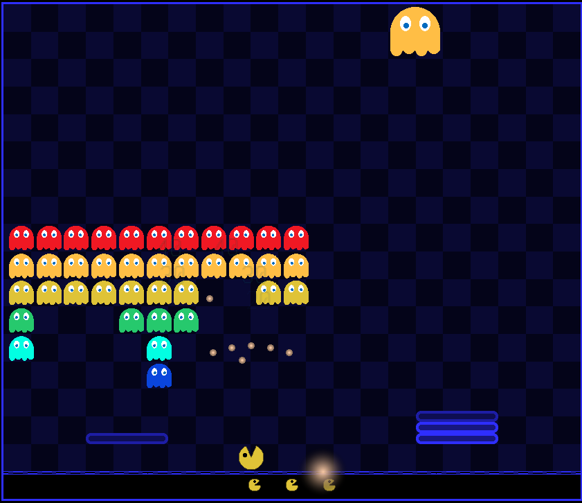
</p>

**Pac-Invaders** (`invaders.py`) reprend les mécanismes d’un jeu de tir à vagues d’ennemis. Son moteur est indépendant de celui du labyrinthe tout en utilisant les composants communs.

$${\color{teal}⋘⊛⋙}$$
<a id="user_interface"></a>

# **$${\color{orange}11. \space Interface \space utilisateur}$$**

<details><summary><strong>Sommaire de la section 🗂️</strong></summary>

- [11.1. Menu principal](#user_interface.main_menu)
- [11.2. HUD et menus de jeu](#user_interface.hud_and_game_menus)
- [11.3. Fin de partie et saisie du nom](#user_interface.endgame_and_name_input)
- [11.4. Guide et crédits](#user_interface.guide_and_credits)

</details>

# [◀️](#mini_games)&nbsp;&nbsp;&nbsp;[⏫](#top)&nbsp;&nbsp;&nbsp;[▶️](#audio)

<a id="user_interface.main_menu"></a>

<p align="center">
  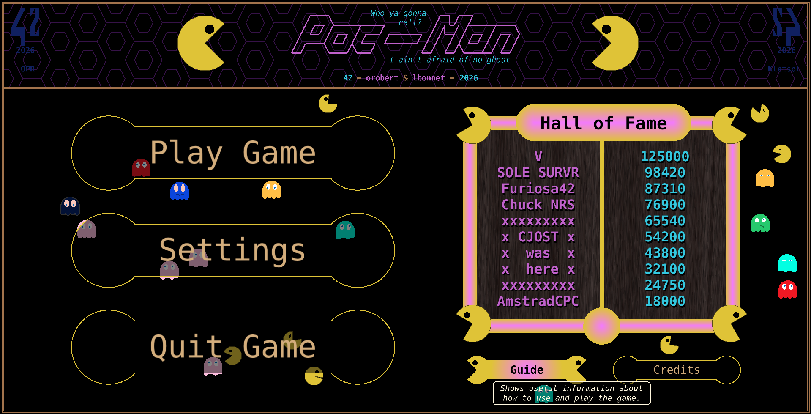
</p>

## **$${\color{violet}11.1. \space Menu \space principal}$$**

Le menu principal permet de commencer une partie, de consulter les scores, d’accéder à l’aide et aux paramètres, de voir les crédits et de quitter le programme. Des animations de fond et un comportement d’inactivité enrichissent l’écran d’accueil.

<a id="user_interface.hud_and_game_menus"></a>

## **$${\color{violet}11.2. \space HUD \space et \space menus \space de \space jeu}$$**

Le HUD affiche les informations indispensables : score, vies restantes, niveau, temps et inventaire. Les menus de pause, paramètres et triche sont gérés dans des modules distincts, ce qui évite de mêler leurs règles d’interaction à celles du plateau.

<a id="user_interface.endgame_and_name_input"></a>

## **$${\color{violet}11.3. \space Fin \space de \space partie \space et \space saisie \space du \space nom}$$**

Les écrans de victoire et de défaite présentent le résultat de la partie. Le joueur peut entrer un nom pour les classements via une interface adaptée au clavier, à la souris et à la manette. Des transitions animées relient les différents états du jeu.

<a id="user_interface.guide_and_credits"></a>

## **$${\color{violet}11.4. \space Guide \space et \space crédits}$$**

Le guide intégré présente les commandes et les règles dans la langue choisie et adaptés au clavier de l'utilisateur. Les crédits et les interludes narratifs possèdent des écrans dédiés.

$${\color{teal}⋘⊛⋙}$$
<a id="audio"></a>

# **$${\color{orange}12. \space Audio}$$**

<details><summary><strong>Sommaire de la section 🗂️</strong></summary>

- [12.1. Musiques et effets](#audio.musics_and_effects)
- [12.2. Gestion audio](#audio.audio_management)
- [12.3. Ressources](#audio.assets)

</details>

# [◀️](#user_interface)&nbsp;&nbsp;&nbsp;[⏫](#top)&nbsp;&nbsp;&nbsp;[▶️](#localization)

<a id="audio.musics_and_effects"></a>

## **$${\color{violet}12.1. \space Musiques \space et \space effets}$$**

Le module `engine/audio.py` centralise la musique et les effets sonores. Raylib fournit les fonctions de lecture ; les ressources sont conservées dans `pacman/assets/audio/`. Le jeu utilise des fichiers WAV pour les effets et MP3 pour les musiques.

<a id="audio.audio_management"></a>

## **$${\color{violet}12.2. \space Gestion \space audio}$$**

La configuration expose des volumes distincts : `master_volume`, `music_volume` et `sound_volume`. Le moteur peut déclencher des effets en réaction aux événements du jeu et gérer les changements de musique entre les écrans et les séquences.

<a id="audio.assets"></a>

## **$${\color{violet}12.3. \space Ressources}$$**

Les fichiers audio sont distribués comme ressources et non générés par le moteur de formes. Les performances et la latence audio dépendent de l’environnement d’exécution ; les tests ont notamment été menés sous Linux, en VM et sur machine native.

$${\color{teal}⋘⊛⋙}$$
<a id="localization"></a>

# **$${\color{orange}13. \space Localisation}$$**

<details><summary><strong>Sommaire de la section 🗂️</strong></summary>

- [13.1. Principe](#localization.principles)
- [13.2. Langues disponibles](#localization.available_languages)
- [13.3. Lexique et typographie](#localization.lexicon_et_typography)
- [13.4. Disposition de clavier](#localization.keyboard_layout)

</details>

# [◀️](#audio)&nbsp;&nbsp;&nbsp;[⏫](#top)&nbsp;&nbsp;&nbsp;[▶️](#configuration)

<a id="localization.principles"></a>

## **$${\color{violet}13.1. \space Principe}$$**

Les textes visibles ne sont pas tous écrits directement dans les modules : `Core.lexicon()` récupère les chaînes à partir des fichiers de langue. Cette séparation facilite les traductions, les variantes humoristiques et la maintenance des menus, du guide et des crédits.

<a id="localization.available_languages"></a>

## **$${\color{violet}13.2. \space Langues \space disponibles}$$**

Les ressources linguistiques comprennent des variantes **française, anglaise, allemande, bretonne, alsacienne**, ainsi que des variantes humoristiques **froggies et pirate**. Les fichiers JSON sont placés dans `pacman/assets/languages/`. Le sous-titre **Escape from Flativerses** demeure volontairement inchangé dans toutes les langues.

<a id="localization.lexicon_et_typography"></a>

## **$${\color{violet}13.3. \space Lexique \space et \space typographie}$$**

Le moteur normalise certains guillemets et apostrophes typographiques pour les besoins du rendu, sauf lorsqu’une chaîne est demandée en mode brut. Les traductions doivent préserver les identifiants du lexique et les éventuels paramètres de substitution.

<a id="localization.keyboard_layout"></a>

## **$${\color{violet}13.4. \space Disposition \space de \space clavier}$$**

Partout où des touches sont affichées, le moteur vérifie quelle est la disposition active dans le système d'exploitation et montre les touches réelles du clavier. Les dispositions AZERTY et QWERTY sont prises en charge. Il est possible d'en changer à la volée.

$${\color{teal}⋘⊛⋙}$$
<a id="configuration"></a>

# **$${\color{orange}14. \space Configuration}$$**

<details><summary><strong>Sommaire de la section 🗂️</strong></summary>

- [14.1. Format et chargement](#configuration.format_and_loading)
- [14.2. Paramètres généraux](#configuration.general_settings)
- [14.3. Paramètres de jeu](#configuration.game_settings)
- [14.4. Niveaux](#configuration.levels)
- [14.5. Gestion des erreurs](#configuration.error_handling)
- [14.6. Menu de paramétrage](#configuration.settings_menu)

</details>

# [◀️](#localization)&nbsp;&nbsp;&nbsp;[⏫](#top)&nbsp;&nbsp;&nbsp;[▶️](#highscores)

<p align="center">
  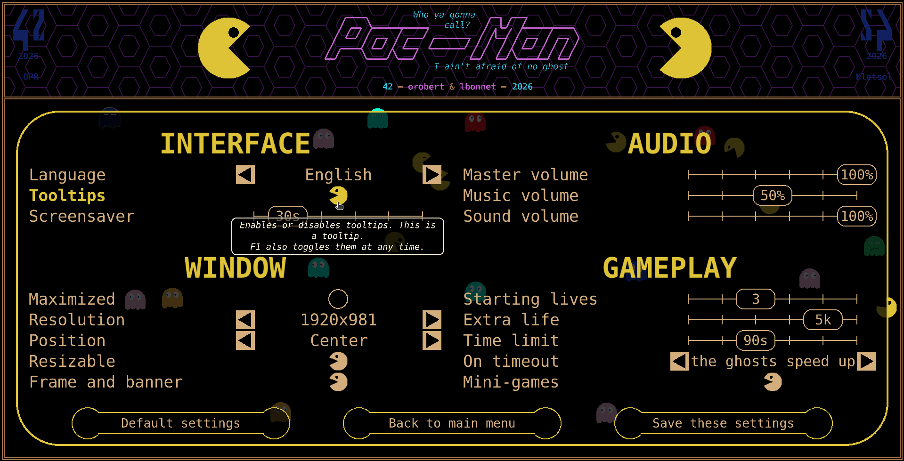
</p>

<a id="configuration.format_and_loading"></a>

## **$${\color{violet}14.1. \space Format \space et \space chargement}$$**

Le programme attend **exactement un argument** : le chemin d’un fichier `.json`. Le chargeur accepte les commentaires sur des lignes commençant par `#`. `ConfigManager` lit, valide, complète et éventuellement répare la configuration ; les clés inconnues sont ignorées. Les valeurs manquantes ou incorrectes sont remplacées par des valeurs sûres et signalées sans traceback.

<a id="configuration.general_settings"></a>

## **$${\color{violet}14.2. \space Paramètres \space généraux}$$**

| Clé | Valeur fournie | Rôle |
|---|---:|---|
| `data_dir` | `data` | Répertoire des données |
| `highscore_filename` | `hall_of_fame.json` | Fichier des classements |
| `window_width` / `window_height` | `1600` / `900` | Dimensions de la fenêtre |
| `window_resizable` | `true` | Redimensionnement |
| `window_maximized` | `true` | Ouverture maximisée |
| `window_position` | `topright` | Position souhaitée |
| `frame_and_banner` | `true` | Habillage de la fenêtre |
| `master_volume` | `100` | Volume général |
| `music_volume` | `50` | Volume musique |
| `sound_volume` | `100` | Volume effets |
| `language` | `français` | Langue initiale |
| `hints` | `true` | Aides contextuelles |
| `hints_delay` | `0.5` | Délai des aides |
| `disable_transitions` | `false` | Désactivation des transitions |
| `minigames` | `true` | Activation des mini-jeux |

<a id="configuration.game_settings"></a>

## **$${\color{violet}14.3. \space Paramètres \space de \space jeu}$$**

| Clé | Valeur fournie | Rôle |
|---|---:|---|
| `lives` | `3` | Vies initiales |
| `pts_pacgum` | `10` | Points d’une pacgum |
| `pts_super_pacgum` | `50` | Points d’une super-pacgum |
| `pts_ghost` | `200` | Points d’un fantôme |
| `pts_bonus1` à `pts_bonus6` | `400` à `900` | Barème des bonus |
| `new_life_threshold` | `5000` | Seuil d’une vie supplémentaire |
| `level_max_time` | `90` | Durée initiale du niveau |
| `timeout_consequence` | `speeding_ghosts` | Conséquence du dépassement du temps |
| `seed` | `42` | Graine du premier niveau |
| `main_menu_idle_time` | `30` | Délai d’inactivité du menu |
| `main_menu_idle_visitor_min_time` | `30` | Délai minimum d’apparition |
| `main_menu_idle_visitor_max_time` | `60` | Délai maximum d’apparition |

<a id="configuration.levels"></a>

## **$${\color{violet}14.4. \space Niveaux}$$**

Le tableau `levels` contient une liste d’objets `{ "width": ..., "height": ... }`. La configuration livrée comporte **12 entrées** : `15×10`, `16×10`, `16×11`, `17×11`, `17×12`, `18×12`, `18×13`, `19×13`, `19×14`, `20×14`, `20×15` et `21×15`. Le chargeur vérifie les dimensions et applique des bornes de sécurité.

<a id="configuration.error_handling"></a>

## **$${\color{violet}14.5. \space Gestion \space des \space erreurs}$$**

La validation se trouve dans `base/config.py`. Les valeurs incorrectes sont corrigées et les événements pertinents sont journalisés. Le programme peut créer une sauvegarde de configuration avant de remplacer un fichier invalide. Les tests de robustesse et de configuration ont été effectués pendant le développement.

<a id="configuration.settings_menu"></a>

## **$${\color{violet}14.6. \space Menu \space de \space paramétrage}$$**

Plutôt que de modifier les paramètres dans le fichier de configuration, il est plus ergonomique de le faire dans le menu dédié. Celui-ci permet de régler les paramètres les plus accessibles du jeu, de restaurer les valeurs par défaut et de sauvegarder les réglages. Ceux-ci remplacent alors ceux présent dans le fichier de configuration.\
Un menu de configuration plus léger est également disponible depuis le menu pause du jeu.

$${\color{teal}⋘⊛⋙}$$
<a id="highscores"></a>

# **$${\color{orange}15. \space Highscores}$$**

<details><summary><strong>Sommaire de la section 🗂️</strong></summary>

- [15.1. Hall of Fame et Wall of Shame](#highscores.hall_of_fame_and_wall_of_shame)
- [15.2. Persistance](#highscores.persistence)
- [15.3. Validation et intégrité](#highscores.validation_and_integrity)

</details>

# [◀️](#configuration)&nbsp;&nbsp;&nbsp;[⏫](#top)&nbsp;&nbsp;&nbsp;[▶️](#instructions)

<p align="center">
  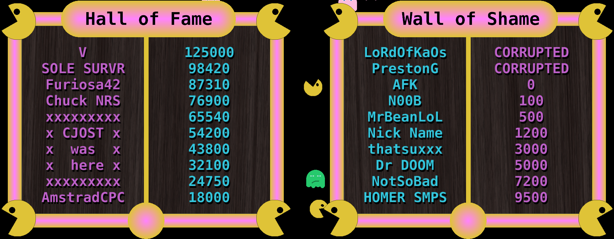
</p>

<a id="highscores.hall_of_fame_and_wall_of_shame"></a>

## **$${\color{violet}15.1. \space Hall \space of \space Fame \space et \space Wall \space of \space Shame}$$**

Le projet maintient deux classements : les **dix meilleurs scores** (*Hall of Fame*) et les **dix moins bons** (*Wall of Shame*). L’interface permet de consulter ces listes et de passer de l’une à l’autre. Cette seconde liste est un ajout volontaire au sujet.

<a id="highscores.persistence"></a>

## **$${\color{violet}15.2. \space Persistance}$$**

`game/highscores.py` assure le chargement et la sauvegarde des scores dans un fichier JSON. Chaque entrée contient un nom et un score entier non négatif. Les noms sont limités à dix caractères alphanumériques ou espaces, conformément au sujet. Le système gère les fichiers absents ou mal formés.

<a id="highscores.validation_and_integrity"></a>

## **$${\color{violet}15.3. \space Validation \space et \space intégrité}$$**

Des signatures et sommes de contrôle sont utilisées pour détecter des altérations des classements. Le mécanisme vise l’intégrité et la détection de modifications accidentelles ou triviales ; il ne constitue pas un système de sécurité cryptographique contre un attaquant disposant du code source.

$${\color{teal}⋘⊛⋙}$$
<a id="instructions"></a>

# **$${\color{orange}16. \space Installation \space et \space utilisation}$$**

<details><summary><strong>Sommaire de la section 🗂️</strong></summary>

- [16.1. Prérequis](#instructions.prerequisites)
- [16.2. Installation](#instructions.installation)
- [16.3. Lancement](#instructions.launch)
- [16.4. Makefile](#instructions.makefile)
- [16.5. Validation statique](#instructions.static_validation)

</details>

# [◀️](#highscores)&nbsp;&nbsp;&nbsp;[⏫](#top)&nbsp;&nbsp;&nbsp;[▶️](#packaging)

<a id="instructions.prerequisites"></a>

## **$${\color{violet}16.1. \space Prérequis}$$**

Le projet nécessite **Python 3.10 ou supérieur**, un environnement Linux graphique et les dépendances indiquées dans `pyproject.toml`. L’installation recommandée utilise **uv**. Les dépendances principales sont `pydantic`, `numpy`, `raylib` et le paquet attribué `mazegenerator`. Les outils de développement incluent `flake8`, `mypy`, `pytest` et `pyinstaller`.

<a id="instructions.installation"></a>

## **$${\color{violet}16.2. \space Installation}$$**

Depuis la racine du dépôt :
```bash
make install
```
ou directement :
```bash
uv sync --dev
```
Le wheel attribué est référencé dans `pyproject.toml` sous `packages/`. Ne pas le modifier.

<a id="instructions.launch"></a>

## **$${\color{violet}16.3. \space Lancement}$$**

Lancement conforme au sujet :
```bash
python3 pac-man.py data/config.json
```
Ou via le Makefile :
```bash
make run
make run_uv
```
La commande `run` suppose que les dépendances sont accessibles dans l’environnement Python actif. `run_uv` les exécute dans l’environnement géré par uv.

<a id="instructions.makefile"></a>

## **$${\color{violet}16.4. \space Makefile}$$**

| Cible | Utilité |
|---|---|
| `install` | Installer les dépendances |
| `run` / `run_uv` | Lancer le jeu |
| `debug` / `debug_uv` | Exécuter avec le débogueur |
| `lint` / `lint-strict` | Vérifier le code |
| `clean` / `fclean` | Nettoyer les fichiers temporaires |
| `build` | Construire le distribuable |
| `inventory` | Produire un inventaire du projet |
Les autres cibles sont des outils de développement et de maintenance.

<a id="instructions.static_validation"></a>

## **$${\color{violet}16.5. \space Validation \space statique}$$**

Les commandes de lint ciblent `pacman/` et `pac-man.py`, afin de ne pas analyser inutilement `.venv`. Elles utilisent **flake8** et **mypy**, y compris une cible `lint-strict`. Les deux ont été exécutées sans erreur sur la version de développement.
```bash
make lint
make lint-strict
```

$${\color{teal}⋘⊛⋙}$$
<a id="packaging"></a>

# **$${\color{orange}17. \space Distribution}$$**

<details><summary><strong>Sommaire de la section 🗂️</strong></summary>

- [17.1. Construction](#packaging.construction)
- [17.2. Ressources embarquées](#packaging.embedded_assets)
- [17.3. Publication](#packaging.publication)

</details>

# [◀️](#instructions)&nbsp;&nbsp;&nbsp;[⏫](#top)&nbsp;&nbsp;&nbsp;[▶️](#performance)

<a id="packaging.construction"></a>

## **$${\color{violet}17.1. \space Construction}$$**

Le projet contient une cible `build` fondée sur **PyInstaller**. Le distribuable Linux a été construit et testé. Le script et les paramètres de construction doivent rester disponibles dans le dépôt afin de permettre une régénération pendant la soutenance.

<a id="packaging.embedded_assets"></a>

## **$${\color{violet}17.2. \space Ressources \space embarquées}$$**

Les ressources embarquées comprennent notamment les fichiers audio, les polices, les langues, l’icône et le shader. Le mode figé détecte l’environnement PyInstaller et désactive l’affichage terminal ; la logique graphique du jeu reste active. Les fichiers de données modifiables, dont les highscores, doivent rester accessibles en écriture.

<a id="packaging.publication"></a>

## **$${\color{violet}17.3. \space Publication}$$**

Le sujet demande une publication gratuite, éventuellement non répertoriée, sur une plateforme de jeux telle qu’Itch.io. **La mise en ligne et son lien seront renseignés par l’équipe une fois la publication effectuée.** Une éventuelle version Windows est une piste ultérieure, non nécessaire à la remise initiale.

$${\color{teal}⋘⊛⋙}$$
<a id="performance"></a>

# **$${\color{orange}18. \space Performances}$$**

<details><summary><strong>Sommaire de la section 🗂️</strong></summary>

- [18.1. Rendu et caches](#performance.renderer_and_caching)
- [18.2. Organisation des mises à jour](#performance.updates_organization)
- [18.3. Limites et mesures](#performance.limits_and_measures)

</details>

# [◀️](#packaging)&nbsp;&nbsp;&nbsp;[⏫](#top)&nbsp;&nbsp;&nbsp;[▶️](#design_decisions)

<a id="performance.renderer_and_caching"></a>

## **$${\color{violet}18.1. \space Rendu \space et \space caches}$$**

Les formes récurrentes sont préparées et réutilisées grâce au cache de textures procédurales. Cette séparation évite de recalculer inutilement certains dessins complexes et permet de conserver un chemin de rendu compatible MLX.

<a id="performance.updates_organization"></a>

## **$${\color{violet}18.2. \space Organisation \space des \space mises \space à \space jour}$$**

Les différents moteurs isolent la mise à jour de l’état et son affichage. Le rendu graphique, les événements de jeu, l’audio et le terminal n’ont pas exactement les mêmes contraintes de fréquence. Le programme possède des mécanismes spécifiques pour gérer les transitions et les animations.

<a id="performance.limits_and_measures"></a>

## **$${\color{violet}18.3. \space Limites \space et \space mesures}$$**

Malgré sa complexité au-delà de ce que prescrivait le sujet, ce programme fonctionne entre 30 et 60 FPS, suffisant pour un rendu visuel fluide et un contrôle réactif. Les tests ont été effectués sur environnement Linux virtualisé et natif.

$${\color{teal}⋘⊛⋙}$$
<a id="design_decisions"></a>

# **$${\color{orange}19. \space Choix \space de \space conception}$$**

<details><summary><strong>Sommaire de la section 🗂️</strong></summary>

- [19.1. Architecture modulaire](#design_decisions.modular_architecture)
- [19.2. Rendu compatible MLX](#design_decisions.MLX_compatible_renderer)
- [19.3. Textures plutôt que fichiers image](#design_decisions.textures_rather_than_image_files)
- [19.4. Extension du gameplay](#design_decisions.gameplay_extension)

</details>

# [◀️](#performance)&nbsp;&nbsp;&nbsp;[⏫](#top)&nbsp;&nbsp;&nbsp;[▶️](#challenges)

<a id="design_decisions.modular_architecture"></a>

## **$${\color{violet}19.1. \space Architecture \space modulaire}$$**

Le projet privilégie des modules spécialisés plutôt qu’un fichier unique. Les sous-systèmes partagent des modèles et une orchestration commune, tout en conservant leurs responsabilités propres. Cette organisation facilite les tests ciblés et l’ajout de fonctionnalités.

<a id="design_decisions.MLX_compatible_renderer"></a>

## **$${\color{violet}19.2. \space Rendu \space compatible \space MLX}$$**

Le choix de Raylib répond au besoin d’une fenêtre, d’entrées et d’audio robustes. La contrainte pédagogique de la MLX a conduit à une couche `Shapes` indépendante des fonctions de dessin avancées, activables seulement comme accélération facultative. Ce compromis permet de conserver la démonstration de conformité sans renoncer aux optimisations.

<a id="design_decisions.textures_rather_than_image_files"></a>

## **$${\color{violet}19.3. \space Textures \space plutôt \space que \space fichiers \space image}$$**

Les textures sont créées à l’exécution plutôt que distribuées sous forme de fichiers image. Ce choix réduit la taille des ressources graphiques, assure une esthétique cohérente et rapproche le fonctionnement d’un cache de rendus réutilisables.

<a id="design_decisions.gameplay_extension"></a>

## **$${\color{violet}19.4. \space Extension \space du \space gameplay}$$**

Les bonus d’inventaire, les mini-jeux, les variantes linguistiques et l’univers narratif sont des extensions assumées. Ils ont été développés autour du cœur obligatoire plutôt qu’à sa place, avec des modules dédiés pour contenir leur complexité.

$${\color{teal}⋘⊛⋙}$$
<a id="challenges"></a>

# **$${\color{orange}20. \space Difficultés \space rencontrées}$$**

<details><summary><strong>Sommaire de la section 🗂️</strong></summary>

- [20.1. Graphismes procéduraux](#challenges.procedural_graphics)
- [20.2. Intégration externe](#challenges.external_integration)
- [20.3. Audio et environnements](#challenges.audio_and_environments)
- [20.4. Complexité croissante](#challenges.increasing_complexity)

</details>

# [◀️](#design_decisions)&nbsp;&nbsp;&nbsp;[⏫](#top)&nbsp;&nbsp;&nbsp;[▶️](#bonus_features)

<a id="challenges.procedural_graphics"></a>

## **$${\color{violet}20.1. \space Graphismes \space procéduraux}$$**

Construire des formes complexes à partir de primitives élémentaires exige une attention particulière aux arrondis, aux contours, aux angles et aux dégradés. Les fonctions de `Shapes` ont été développées pour rendre ces compositions réutilisables dans l’ensemble du jeu.

<a id="challenges.external_integration"></a>

## **$${\color{violet}20.2. \space Intégration \space externe}$$**

L’interface du générateur attribué n’exposait pas tous les paramètres nécessaires. L’adaptateur a donc dû préparer certains attributs internes avant la génération, sans modifier le paquet lui-même. Cette dépendance à l’interface attribuée est explicitée pour faciliter la soutenance.

<a id="challenges.audio_and_environments"></a>

## **$${\color{violet}20.3. \space Audio \space et \space environnements}$$**

Les environnements Linux virtualisés et natifs ne présentent pas exactement le même comportement audio et graphique. Le développement a nécessité des tests comparatifs, notamment autour de la latence audio et des entrées clavier.

<a id="challenges.increasing_complexity"></a>

## **$${\color{violet}20.4. \space Complexité \space croissante}$$**

Les fonctionnalités bonus ont progressivement augmenté le nombre de modules et d’états à coordonner. La séparation entre `engine`, `game`, `graphics` et `minigames` est une réponse à cette complexité, plutôt qu’une tentative de tout gérer dans une seule boucle monolithique.

$${\color{teal}⋘⊛⋙}$$
<a id="bonus_features"></a>

# **$${\color{orange}21. \space Fonctionnalités \space bonus}$$**

<details><summary><strong>Sommaire de la section 🗂️</strong></summary>

- [21.1. Au-delà du sujet](#bonus_features.beyond_the_subject)
- [21.2. Narration et univers](#bonus_features.narratives_and_universe)
- [21.3. Accessibilité et confort](#bonus_features.accessibility_and_comfort)

</details>

# [◀️](#challenges)&nbsp;&nbsp;&nbsp;[⏫](#top)&nbsp;&nbsp;&nbsp;[▶️](#project_management)

<a id="bonus_features.beyond_the_subject"></a>

## **$${\color{violet}21.1. \space Au-delà \space du \space sujet}$$**

Les extensions comprennent quatre mini-jeux, un inventaire, des objets spéciaux, des effets de triche supplémentaires, des menus et animations élaborés, ainsi que des classements distincts pour les meilleurs et les moins bons scores.

<a id="bonus_features.narratives_and_universe"></a>

## **$${\color{violet}21.2. \space Narration \space et \space univers}$$**

Les interludes et les textes narratifs constituent une identité propre au projet. L’univers fait notamment référence à l’Évangile de la Pac-Amama et au journal de Pac-Man, dont la chronologie s’appuie sur la date historique de sortie du jeu, le **22 mai 1980**.

<a id="bonus_features.accessibility_and_comfort"></a>

## **$${\color{violet}21.3. \space Accessibilité \space et \space confort}$$**

Le jeu propose plusieurs méthodes de contrôle, des paramètres d’affichage et d’audio, des aides contextuelles, une localisation étendue et des moyens de démontrer rapidement les fonctionnalités. Bon nombre de ces options dépassent les exigences minimales du sujet.

$${\color{teal}⋘⊛⋙}$$
<a id="project_management"></a>

# **$${\color{orange}22. \space Gestion \space de \space projet}$$**

<details><summary><strong>Sommaire de la section 🗂️</strong></summary>

- [22.1. Organisation du binôme](#project_management.pair_organisation)
- [22.2. Documents et suivi](#project_management.documents_and_follow_up)
- [22.3. Tests d’acceptation](#project_management.acceptance_tests)

</details>

# [◀️](#bonus_features)&nbsp;&nbsp;&nbsp;[⏫](#top)&nbsp;&nbsp;&nbsp;[▶️](#resources)

<a id="project_management.pair_organisation"></a>

## **$${\color{violet}22.1. \space Organisation \space du \space binôme}$$**

Le projet a été mené conjointement par **orobert** et **lbonnet**. orobert a principalement travaillé sur le rendu graphique, l’adaptation du labyrinthe, les mini-jeux et l’univers narratif ; lbonnet sur la gestion de projet, le distribuable, les tests et la recherche de bugs. Les idées et décisions ont été discutées en commun.

<a id="project_management.documents_and_follow_up"></a>

## **$${\color{violet}22.2. \space Documents \space et \space suivi}$$**

Les documents de suivi sont regroupés dans [`project_management/`](project_management/) :
- `Project analysis.md` : choix techniques et organisation ;
- `Risks_analysis.md` : analyse des risques ;
- `Acceptance test plan.md` : plan de tests et corrections.
Ils constituent la référence pour les décisions, les difficultés et les vérifications effectuées.

<a id="project_management.acceptance_tests"></a>

## **$${\color{violet}22.3. \space Tests \space d’acceptation}$$**

Des essais ont été réalisés par les auteurs et par d’autres étudiants. Les tests sur site ont été principalement conduits par lbonnet. Les résultats et les bugs corrigés sont détaillés dans le plan de tests d’acceptation ; le README n’a pas vocation à reproduire intégralement ce registre.

$${\color{teal}⋘⊛⋙}$$
<a id="resources"></a>

# **$${\color{orange}23. \space Ressources}$$**

<details><summary><strong>Sommaire de la section 🗂️</strong></summary>

- [23.1. Documentation](#resources.documentation)
- [23.2. Dépendances et outils](#resources.tools_and_dependencies)
- [23.3. Ressources artistiques](#resources.art_resources)

</details>

# [◀️](#project_management)&nbsp;&nbsp;&nbsp;[⏫](#top)&nbsp;&nbsp;&nbsp;[▶️](#ai_usage)

<a id="resources.documentation"></a>

## **$${\color{violet}23.1. \space Documentation}$$**

Les références techniques principales sont la documentation officielle de Python, les recommandations PEP 8 et PEP 257, la documentation de **Raylib**, celle de **PyInstaller**, celle de **uv**, ainsi que les règles et spécifications du projet Pacman de l’école 42. Les documents du générateur A-Maze-ing attribué complètent ces références techniques.

Il faut y ajouter le fonctionnement historique de Pac-Man et des autres mini-jeux :
- [Pac-Man Wiki](https://pacman.fandom.com/wiki/Pac-Man_Wiki)
- [The Psychology of Snake](https://theoriginalsnake.com/blog/psychology-of-snake)
- [The story of Breakout](https://www.denofgeek.com/games/the-story-of-breakout/)
- [The History of Tetris](https://tetris.com/news/the-history-of-tetris)
- [Play Guide for Space Invaders](https://classicgaming.cc/classics/space-invaders/play-guide)

<a id="resources.tools_and_dependencies"></a>

## **$${\color{violet}23.2. \space Dépendances \space et \space outils}$$**

| Élément | Utilisation |
|---|---|
| Python 3.10+ | Langage et bibliothèque standard |
| Raylib / pyray | Fenêtre, entrées, audio et support de rendu |
| Pydantic | Modèles et validation |
| A-Maze-ing | Génération externe des labyrinthes |
| uv | Gestion de l’environnement et des dépendances |
| flake8 / mypy | Contrôles statiques |
| PyInstaller | Construction du distribuable |

<a id="resources.art_resources"></a>

## **$${\color{violet}23.3. \space Ressources \space artistiques}$$**

Les ressources livrées comprennent des fichiers audio, des polices, des traductions, une icône et un shader. Bien que n'ayant pas répondu à la proposition d'utilisation de leurs oeuvres, les artistes musicaux sont crédités au générique.

- [Pacman Theme Song 2026 par Trap Music Now](https://www.youtube.com/watch?v=DKzklEBZAa4)
- [Pacman Dubstep Remix par GokuSaiyajin](https://www.youtube.com/watch?v=mR0GTrIfEjw)
- [Pac-Man Remix Remastered par Multiversal Music](https://www.youtube.com/watch?v=XsYc9Xv6oMY)
- [Pac-Man Theme Remix par Arsenic 1987](https://www.youtube.com/watch?v=qtZ0hl-unM4)

$${\color{teal}⋘⊛⋙}$$
<a id="ai_usage"></a>

# **$${\color{orange}24. \space Utilisation \space de \space l’IA}$$**

<details><summary><strong>Sommaire de la section 🗂️</strong></summary>

- [24.1. Périmètre](#ai_usage.perimeter)
- [24.2. Méthode de vérification](#ai_usage.verification_methods)
- [24.3. Responsabilité des auteurs](#ai_usage.authors_responsibility)

</details>

# [◀️](#resources)&nbsp;&nbsp;&nbsp;[⏫](#top)&nbsp;&nbsp;&nbsp;[▶️](#final_thoughts)

<a id="ai_usage.perimeter"></a>

## **$${\color{violet}24.1. \space Périmètre}$$**

Des outils d’IA ont été utilisés comme **assistance au développement et à la documentation** : exploration d’idées, discussion de choix d’architecture, aide au débogage, traduction et révision de textes, préparation de tests et rédaction documentaire. L’utilisation de l’IA n’exonère pas les auteurs de comprendre, vérifier et assumer chaque partie du projet.

<a id="ai_usage.verification_methods"></a>

## **$${\color{violet}24.2. \space Méthode \space de \space vérification}$$**

Les propositions ont été confrontées au code réel, aux contraintes du sujet et à des tests. Les mécanismes sensibles, notamment le rendu compatible MLX, le générateur externe, les configurations incorrectes et le distribuable, ont fait l’objet de vérifications spécifiques. Les traductions sont relues en tenant compte de leurs particularités linguistiques.

<a id="ai_usage.authors_responsibility"></a>

## **$${\color{violet}24.3. \space Responsabilité \space des \space auteurs}$$**

La conception, l’intégration, les essais et les décisions finales restent sous la responsabilité de **orobert** et de **lbonnet**.

$${\color{teal}⋘⊛⋙}$$
<a id="final_thoughts"></a>

# **$${\color{orange}25. \space Bilan}$$**

<details><summary><strong>Sommaire de la section 🗂️</strong></summary>

- [25.1. Résultats](#final_thoughts.results)
- [25.2. Chiffres](#final_thoughts.numbers)
- [25.3. Perspectives](#final_thoughts.perspectives)

</details>

# [◀️](#ai_usage)&nbsp;&nbsp;&nbsp;[⏫](#top)&nbsp;&nbsp;&nbsp;[▶️](#contributors)

<a id="final_thoughts.results"></a>

## **$${\color{violet}25.1. \space Résultats}$$**

Le projet satisfait les mécanismes attendus d’un Pac-Man multi-niveaux et s’est progressivement développé en un jeu doté de nombreux systèmes supplémentaires. Son intérêt technique réside autant dans le gameplay que dans la composition graphique procédurale, l’organisation des modules et les outils de validation.

<a id="final_thoughts.numbers"></a>

## **$${\color{violet}25.2. \space Chiffres}$$**

Pac-Man - Escape from Flativerses, c'est aussi :

| Catégorie | Quantité|
|---|---|
| Modules Python | **54** |
| Classes | **106** |
| Fonctions | **1 011** |
| Lignes de code | **31 123** |
| Lignes de texte | **7 378** |
| Caractères | **1 790 949** |
| Heures de travail | *Beaucoup* |
| Heures de plaisir | *Beaucoup aussi* |

<a id="final_thoughts.perspectives"></a>

## **$${\color{violet}25.3. \space Perspectives}$$**

Ce projet peut également être généré et distribué sous la forme d’un exécutable Windows autonome, bien que la prise en charge de Windows ne fasse pas partie du périmètre initial du projet.\
Il est peu probable que les projets futurs mentionnés au générique voient le jour. Nous nous en excusons.

$${\color{teal}⋘⊛⋙}$$
<a id="contributors"></a>

# **$${\color{orange}26. \space Contributeurs}$$**
# [◀️](#final_thoughts)&nbsp;&nbsp;&nbsp;[⏫](#top)&nbsp;&nbsp;&nbsp;[▶️](#bottom)

- **orobert** aka **OPR**\
    _Développement du jeu, rendu graphique, adaptation du générateur, mini-jeux, univers narratif et intégration générale_
- **lbonnet** aka **Kletsol**\
    _Gestion de projet, préparation et tests du distribuable, tests d’acceptation, recherche et correction de bugs, participation aux décisions et aux améliorations_
- **Testeuses et testeurs**\
    _Remontées enthousiastes et signalement de bugs_
- **ChatGPT**\
    _Explications sur les mécanismes, débogage, suggestions_
- **Étudiantes et étudiants** de **42 Mulhouse**\
    _Réflexions, café et soutien moral_

$${\color{teal}⋘⊛⋙}$$
<a id="bottom"></a>

# **$${\color{yellow}Merci \space pour \space votre \space temps}$$**

<p align="center">
  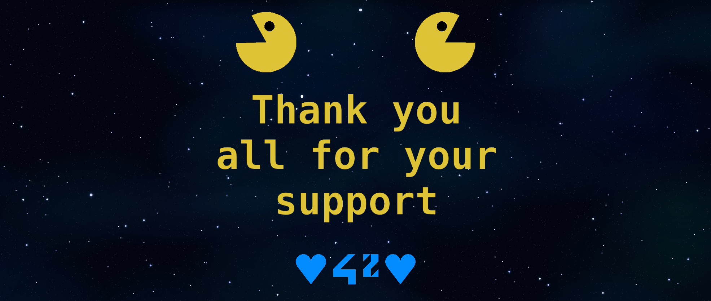
</p>

$${\color{teal}⋘⊛⋙}$$

###### $${\color{darkgrey}_s\space_i\space\space\space_v\space_o\space_u\space_s\space\space\space_p\space_o\space_u\space_v\space_e\space_z\space\space\space_l\space_i\space_r\space_e\space\space\space_c\space_a\space_,\space\space\space_v\space_o\space_u\space_s\space\space\space_p\space_o\space_u\space_v\space_e\space_z\space\space\space_b\space_a\space_l\space_a\space_n\space_c\space_e\space_r\space\space\space_v\space_o\space_s\space\space\space_l\space_u\space_n\space_e\space_t\space_t\space_e\space_s\space_.}$$